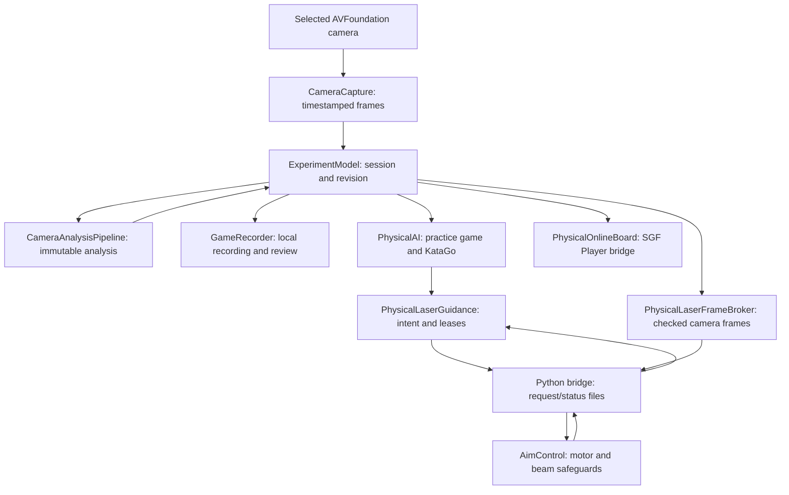

# Architecture and state ownership

[Start here](README.md) · [Current status](../IntegrationChecklist.md)

Physical Go is an independent SwiftUI macOS app inside the SGFPlayerClean
repository. It reuses authoritative Go models and engine code rather than
maintaining a second copy. The pointer is a separate firmware/Python project;
the app does not issue serial motor commands.

The online physical-board bridge exists, but the authoritative online-opponent
laser target producer and camera/laser integration remain a separate work item.
The protocol accepting `source: online` does not establish that end-to-end path.

## Entry points by responsibility

| Owner | Main source | Boundary |
|---|---|---|
| App lifecycle | [PhysicalGoApp.swift](../../Sources/PhysicalGoApp.swift) | Constructs `ExperimentModel`, starts requested camera/session flows, and coordinates shutdown. |
| Session/presentation | [ExperimentModel.swift](../../Sources/ExperimentModel.swift), [ExperimentView.swift](../../Sources/ExperimentView.swift) | Selects mode, camera and references; dispatches immutable analysis; rejects results from old revisions. |
| Camera/vision | [CameraCapture.swift](../../Sources/CameraCapture.swift), [CameraAnalysisPipeline.swift](../../Sources/CameraAnalysisPipeline.swift) | Frame delivery and observation, not legal game decisions or clock ownership. |
| Local recording | [GameRecorder.swift](../../Sources/GameRecorder.swift) | Accepted game transitions, reconciliation, review and local clock coordination. |
| Scoring and game analysis | [PhysicalScoring.swift](../../Sources/PhysicalScoring.swift), [PhysicalGameReview.swift](../../Sources/PhysicalGameReview.swift) | Analysis and explicit scoring approval; never silently rewrites recorded moves. |
| AI practice | [PhysicalAI.swift](../../Sources/PhysicalAI.swift) | Legal AI/human turns, physical mirroring, capture guidance and AI snapshot persistence. |
| Online physical board | [PhysicalOnlineBoard.swift](../../Sources/PhysicalOnlineBoard.swift) | Local ephemeral bridge to SGF Player; credentials remain in SGF Player. |
| Legal board model | [SGFPlayerEngine.swift](../../../SGFPlayerClean/Models/SGFPlayerEngine.swift), [OGSModels.swift](../../../SGFPlayerClean/Models/OGSModels.swift) | Rules, placement/capture simulation, legal input and replay. |
| App laser contract | [PhysicalLaserGuidance.swift](../../Sources/PhysicalLaserGuidance.swift) | Requested indication/standby, lease/revision, status interpretation and dark-frame admission. |
| Optical frame broker | [PhysicalLaserFrameBroker.swift](../../Sources/PhysicalLaserFrameBroker.swift) | Latest checked image and exact timestamp/epoch identity; no second camera client. |
| Hardware orchestration | [bridge_runtime.py](</Users/dave/Personal/Fab Files/DYNAMIXEL Go Pointer/Firmware/bridge_runtime.py>) | Single consumer, generation cancellation, worker lifecycle and verified hardware status. |
| Motor controller | [AimControl.ino](</Users/dave/Personal/Fab Files/DYNAMIXEL Go Pointer/Firmware/AimControl/AimControl.ino>) | Actual motor/beam state and local hardware guards. Source version and installed firmware may differ. |

## Four states that must not be confused

1. **Observed board:** camera classifications, uncertainty, hand obstruction and
   alignment. An old expected label is not a fresh positive observation.
2. **Logical game:** accepted legal history, turn, captures and rules. An AI move
   is logically recorded before its stone is placed on the physical board.
3. **Physical guidance:** what the human must place, remove or center. A marker
   helps reconcile observation with the game; it does not commit a move.
4. **Hardware:** beam, motor torque and bus power. A command request is not a
   state acknowledgement. Darkness does not necessarily mean motor power is off.

Clock ownership follows game events, not image publication or pointing progress.
See [Game, AI and clocks](GameAIClocks.md) before changing acceptance or recovery.

## Concurrency and stale work

Camera processing uses immutable inputs on a serial worker. `ExperimentModel`
checks its revision before applying results. [LatestAnalysisInput.swift](../../Sources/LatestAnalysisInput.swift)
keeps one replaceable pending input rather than building an image backlog.

The laser has another identity boundary: app producer UUID, immutable request
revision, game session, camera context and stream epoch. The host invalidates an
old command generation before cancellation; a late worker result cannot authorize
a later request. Temperature and lease supervision must continue while optical
work is busy. See the [laser page](LaserControlCalibration.md) for protocol details.

Local storage uses ordered background writes through
[RecordingStorage.swift](../../Sources/RecordingStorage.swift). A storage failure
pauses dependent work and requires an explicit retry path; do not use diagnostic
text as the source of a domain or persistence decision.

## Scoped transient recovery

The installed recovery implementation places the classified transient OFF barrier, witness
streak and target-verifier handoff in the pure
[PhysicalGuidanceRecovery](../../Sources/PhysicalGuidanceRecovery.swift) reducer.
The existing guidance facade still authenticates receipts and owns wire/IO,
thermal, hard-fault and legacy-hand policy. See the
[origin and validation record](../GuidanceRecoveryExtraction.md). It is integrated
in the installed 0.260 lineage; later transition/link-loss policy remains owned by
the facade and AI controller, with coordinated host support.

Live bridge reads/writes use independent bounded background queues in
[LatestFileExchange.swift](/Users/Dave/SGFPlayerClean-worktrees/camera-safety-delivery/PhysicalGo/Sources/LatestFileExchange.swift). Ephemeral
publication uses [EphemeralAtomicFile.swift](/Users/Dave/SGFPlayerClean-worktrees/camera-safety-delivery/PhysicalGo/Sources/EphemeralAtomicFile.swift).
PNG preparation can overlap analysis. In 0.261 the broker publishes a separate
checked safety message independently; the optical manifest still waits for its
exact PNG. See [camera freshness](../CameraFreshnessReliability.md)
for measured delays and [the delivery change](../CameraSafetyDelivery.md). Offline
stall checks pass, but sustained physical reliability remains unverified.
