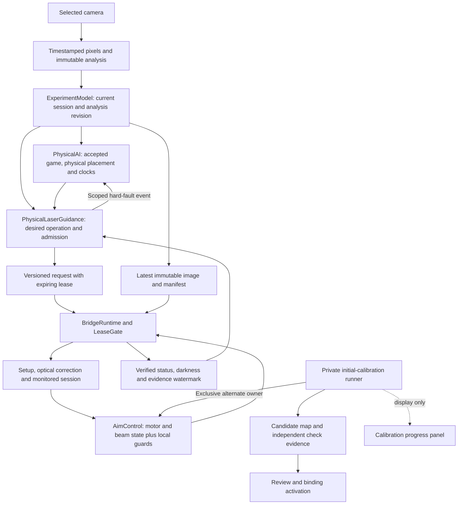

# Architecture and development-process review

**Current follow-through, November25:** independent safety metadata, background native bridge exchange, scoped transient recovery, immutable build tooling and mandatory paired acceptance are implemented in installed0.265/native1f6fb91 + hostb9a524e. Sustained600ms reliability remains open; safety metadata is not a proposal. The [current source audit and assigned offline work](ArchitectureFollowThrough20261125.md) identify remaining supervision I/O, admission-state and evidence boundaries. The [issue register](IntegrationChecklist.md) owns installation and physical acceptance.

## Historical review — November23 source snapshot

The body below is preserved as the original review. Its then-current findings, source links and proposed sequencing must not be treated as unimplemented work or a mandatory new calibration tour today.

Reviewed November 23, 2026 (Pacific). This is an independent source/document review,
not a build, installation, hardware test or safety certification. Current running
state belongs in [IntegrationChecklist.md](/Users/dave/SGFPlayerClean/PhysicalGo/Documentation/IntegrationChecklist.md).

**The broad architecture is appropriate. A wholesale rewrite is not justified.**
The native app should own the legal game and camera, the host should own optical
operations, and the controller should retain independent motor/beam protections.
Those boundaries already exist. The main structural weakness is the amount of
coordination compressed into the native guidance controller: request revisions,
camera evidence, several recovery paths, hardware status, display strings and
synchronous game callbacks interact inside one mutable object.

Recent repairs are meaningful, but continuing to add independent flags and special
cases there will become progressively harder to verify. The next structural step
should be a small, pure recovery/admission state machine behind the existing
interfaces, supported by tests that exercise complete sequences across languages.
Keep the current bounded repairs for the immediate supervised test; do not replace
working safeguards while commissioning the moved setup.

## Scope and evidence

Inspected the native camera/analysis/guidance/game/persistence path; Python request,
lease, setup, optical, thermal and publication layers; v44 controller supervision;
calibration and progress publishing; build/test infrastructure; current checklist,
agent guide, timing/continuity reviews and shared handoff. Related agents supplied
rationale and identified repaired failure modes. This review does not claim access
to other historical chats or exhaustive analysis of all recognition algorithms.
No production files, game data, camera, controller or running app were changed.

The baseline Git HEADs were app `50f28df5d6296cb37163bfdf7ff6d7c1a63fd6a0`
and laser `98298a410bb5da9b19939bb77ab07b8cd1964846`; the review also includes
uncommitted candidate changes. Selected SHA-256 fingerprints:

| File | Reviewed content hash |
|---|---|
| `PhysicalLaserGuidance.swift` | `e7df1f1de93e5685910b79eb82e3a1e9f789f7e91fcc4271c94c85bc8ff6eae0` |
| `PhysicalAI.swift` | `4009c2d35dd8b9d60b13afd778cec1c47db105f6d78fbd009284ef8d6d1797e7` |
| `ExperimentModel.swift` | `8c77f2f49d20a5e42c66a8469802dc79c64e00650ea98913df76ecc197f3a30d` |
| `bridge_runtime.py` | `76e285cf7158b57289806848c51654f20448326dd14cce20d447db23a10b9c10` |
| `bridge_gameplay.py` | `62cf7169a33fa7c84be9590ee296f0d5b71a6327beffbf9dcc46fd7d9eac4d5b` |
| `commission_gameplay_calibration.py` | `d1c740492f38e4295058aa67bf0e5af9b85fec3b97a4e35d53dbc43057be4fe2` |
| `calibration_progress.py` | `1212a24a1f1ac6d5c5e9d7131d37133dfd0ed072dd60eef6fc350243f503d9ab` |

Line links describe that snapshot and may move. The final combined native
regression was running during review; passing results reported for earlier
snapshots do not certify every later source change.

## Actual authority and data flow

| Fact | Authority | Must not be substituted by |
|---|---|---|
| Accepted moves and elapsed AI-practice time | `PhysicalAI` and authoritative atomic `current.json`; Go engine checks legality | A laser receipt, a progress bar or an expected stone label |
| Current camera observation | Exact frame/epoch, pixels, capture timestamps and checked analysis | A newer manifest timestamp or an earlier clear frame |
| Desired indication/holding | Native scoped request and finite lease | A host heartbeat that renews user intent on its own |
| Measured motor/beam state | Controller receipts and causal telemetry, validated by host | A command being queued or conservative `laserOn=true` uncertainty |
| Permission to recognize after possible illumination | Verified darkness plus a newer flushed camera observation | Merely requesting OFF |
| Optical setup | Validated setup/model/reference binding | Finishing one point, finishing the UI progress bar, or editing an identity field |
| Calibration progress | Best-effort display snapshot | Any permission to move, light, accept a stone or activate a map |

These are complementary authorities, not competing copies of the same truth.
Likewise, local AI practice clocks and online server clocks must remain separate.
The online authoritative laser target producer is still pending; accepting an
`online` value in a protocol does not implement online gameplay.

## What is already sound

- **Legal state is separate from physical reconciliation.** An AI answer can be
  committed logically while `pendingPlacement` and prisoner identity track what
  the human must still do. The saved game is authoritative and SGF is derived.
  [Persistence and board reconstruction](/Users/dave/SGFPlayerClean/PhysicalGo/Sources/PhysicalAI.swift:189).
- **Stale work is fenced at several necessary boundaries.** Analysis has a
  revision; images have epoch plus frame ID; requests have producer, sequence and
  immutable scope; hardware workers have revocable generations. These prevent
  different kinds of stale work and should not be collapsed into one timestamp.
  [Analysis acceptance](/Users/dave/SGFPlayerClean/PhysicalGo/Sources/ExperimentModel.swift:1419),
  [lease revocation](</Users/dave/Personal/Fab Files/DYNAMIXEL Go Pointer/Firmware/bridge_lease.py:158>).
- **Image processing and priority hardware supervision are substantially
  separated.** Camera compression has a latest-only background queue, host
  supervision is independent of optical workers, and firmware stops locally on
  communication/motor faults. A slow image calculation cannot simply extend the
  hardware lease. [Frame broker](/Users/dave/SGFPlayerClean/PhysicalGo/Sources/PhysicalLaserFrameBroker.swift:6),
  [host supervision](</Users/dave/Personal/Fab Files/DYNAMIXEL Go Pointer/Firmware/bridge_runtime.py:116>),
  [controller loop](</Users/dave/Personal/Fab Files/DYNAMIXEL Go Pointer/Firmware/AimControl/AimControl.ino:641>).
- **Full OFF, powered darkness and uncertain output are treated differently.**
  Retain this distinction. It underpins recognition flush, monitored holding,
  explicit recovery and honest UI status.
- **The staged calibration change corrects the conceptual boundary.** Older
  stationary geometry is analyzed separately from current clearance and scene
  consistency. It does not claim that a new timestamp refreshes old pixels.
  [Staged admission](</Users/dave/Personal/Fab Files/DYNAMIXEL Go Pointer/Firmware/Tools/commission_gameplay_calibration.py:374>).
- **The new progress display is properly subordinate.** Its worker performs
  display IO separately; exceptions cannot bypass OFF; completion means a
  candidate still requiring review. This is a useful pattern for other optional
  diagnostics. [Publisher](</Users/dave/Personal/Fab Files/DYNAMIXEL Go Pointer/Firmware/calibration_progress.py:27>).

## Prioritized findings

### 1. Highest structural priority: make recovery an explicit state machine

**Confirmed structural problem; associated defects have candidate repairs.**
`PhysicalLaserGuidance` owns transient recovery, old hand-recovery witnesses,
suppression, blocked moves, standby latches, durable game recheck, manual darkness,
arming and illumination history. `tick()` reads status, mutates those states,
chooses a request, writes a file, updates display strings and synchronously calls
back into the game. Several public setters immediately call `tick()` again.
[State fields](/Users/dave/SGFPlayerClean/PhysicalGo/Sources/PhysicalLaserGuidance.swift:115),
[recovery](/Users/dave/SGFPlayerClean/PhysicalGo/Sources/PhysicalLaserGuidance.swift:505),
[tick and effects](/Users/dave/SGFPlayerClean/PhysicalGo/Sources/PhysicalLaserGuidance.swift:557).

The observed failure modes follow from this coupling: a transient host fault
became a permanent standby latch; recovery depended on an error echo erased by
a new OFF revision; unknown possible light implied a hard thermal diagnosis;
a new AI target during recovery invalidated the old targetless proof; and frame
arrival before its analysis could reset valid recovery witnesses. Synchronous
hard-fault callbacks also required generation checks inside game consumption.
These are lifecycle interactions, not evidence that camera recognition or the
motor model needs wholesale replacement.

**Increment:** extract one pure `GuidanceRecovery` reducer first. Its inputs are
explicit events carrying immutable scope/revision, status, camera verdict and
clock samples. It owns the OFF barrier, witness streak and recovery disposition;
it emits decisions, not file writes or callbacks. Keep the existing facade and
wire contract. Consolidate the older and new recovery paths only after trace
parity is demonstrated. Later separate request publication and UI formatting.
Do not replace independent firmware protection with this reducer.

**Acceptance:** replay all current ordinary-hand, camera/lease, delayed-OFF,
new-target, old-revision, changed-scope and hard-fault traces with identical or
explicitly reviewed behavior; no repeated revision churn, automatic hard-fault
clearance, phantom move or extra clock charge. Compare event traces before
switching the facade. **Cost/risk:** medium; migration can accidentally change
ordering, so make this a separate checkpoint after the supervised test.

### 2. High priority: specify status semantics and test full conversations

**Confirmed protocol ambiguity; partially repaired.** Host `laserOn=true` can
mean unknown output pending OFF, while `illuminationConfirmed=true` means positive
illumination. `requiresNewRevision` describes admission, not whether the local
game must pause. Error classification now distinguishes five hard reasons and
four transient reasons, but their meaning is still represented by manually
maintained strings/conditionals on both sides.
[Actual status publisher](</Users/dave/Personal/Fab Files/DYNAMIXEL Go Pointer/Firmware/bridge_runtime.py:402>),
[host taxonomy](</Users/dave/Personal/Fab Files/DYNAMIXEL Go Pointer/Firmware/bridge_errors.py:17>),
[native hard classification](/Users/dave/SGFPlayerClean/PhysicalGo/Sources/PhysicalLaserGuidance.swift:719).

The initial cross-language fixtures used a fake backend that always supplied
fresh thermal data. They therefore missed a real bootstrap combination. New
fixtures include that case and ordered recovery chains. This is an improvement,
but the native test still consumes rebased fixture snapshots rather than running
both complete processes together, and the fixture portion is optional unless its
environment variable is set.
[Fixture backend](</Users/dave/Personal/Fab Files/DYNAMIXEL Go Pointer/Firmware/Host tests/test_gameplay_fault_contract_review.py:46>),
[native fixture opt-in and rebasing](/Users/dave/SGFPlayerClean/PhysicalGo/Tests/PhysicalAIGuidanceContinuityTests.swift:195).

**Increment:** maintain a small versioned contract table/schema for states,
output certainty, reason classification, revision requirements and mandatory
fields. Decode it into typed native values at the boundary; retain unknown codes
explicitly rather than guessing severity. Keep independent freshness checks.
Add one offline paired acceptance command that exports actual Swift requests,
feeds the production Python parser/runtime with fake hardware, returns its actual
statuses to native consumers, and checks complete sequences. Contract acceptance
must fail clearly if required fixtures/provenance are absent. Then add bounded
scheduling permutations and replay recorded failures.

**Acceptance:** assert both safety (no unauthorized light/recognition) and
liveness (ordinary interruption eventually restores the same pending task under
healthy inputs). Include startup, status delay, new AI target, restart and
partial captures; keep explicit checks for unchanged clocks/history. **Cost:**
small for a contract table/mandatory paired command; medium for the loop harness.
A full wire-version redesign is not needed before the current test.

### 3. Reliability priority: reduce avoidable blocking in renewal/supervision

**Verified coupling; future failure risk, not a proven cause of every stop.**
The native 200ms timer and guidance methods run on the main actor, while `tick()`
synchronously reads/decodes status and atomically writes a request. Native
analysis callbacks also return through the main queue. A UI/storage stall can
therefore delay both fresh evidence and request renewal. On the host,
`supervise_once()` hashes setup files and refreshes metadata before thermal
service, then writes thermal logs synchronously. These operations are outside
the priority gate lock, which is good, but can still delay the next service pass.
[Native timer](/Users/dave/SGFPlayerClean/PhysicalGo/Sources/PhysicalLaserGuidance.swift:231),
[native IO](/Users/dave/SGFPlayerClean/PhysicalGo/Sources/PhysicalLaserGuidance.swift:562),
[analysis dispatch](/Users/dave/SGFPlayerClean/PhysicalGo/Sources/CameraAnalysisPipeline.swift:67),
[host refresh](</Users/dave/Personal/Fab Files/DYNAMIXEL Go Pointer/Firmware/bridge_gameplay.py:69>),
[thermal/log loop](</Users/dave/Personal/Fab Files/DYNAMIXEL Go Pointer/Firmware/bridge_gameplay.py:231>).

Expiry is the appropriate safe response, but repeated avoidable expiry is poor
availability during a game. Replacing file IPC with sockets is not yet justified
by measurements: the recorded commissioning read-path experiment did not improve
the delay tail. First instrument duration and scheduling gaps by stage.

**Increment:** move optional thermal logging to a bounded best-effort writer;
separate current safety metadata refresh from static artifact verification with
an explicit unchanged-binding contract; isolate native transport IO behind a
serial, latest-intent adapter. Any IO worker must publish only intent with its
original finite authority—it must not keep renewing stale game/camera intent
while the main actor is stuck. Preserve priority OFF and revoke stale generations.

**Acceptance:** inject blocked status reads, slow writes/logging and delayed main
callbacks. Hardware must expire safely, stale requests must never relight, and
healthy recovery must remain possible. Measure end-to-end move-to-light and
hand-to-dark separately; no OS scheduling allowance is a guaranteed physical
reaction bound. **Cost/risk:** medium; defer transport replacement until data
shows a remaining bottleneck.

### 4. Important policy gap: camera failure and game continuity are separate

**Known unresolved behavior, not newly introduced by the current patch.**
`handleCameraStatus` invalidates laser/camera evidence and suspends the local
recorder; confirmed alignment loss similarly suspends recording. Neither path
explicitly pauses the AI game. The new AI pause boundary is scoped hard *laser*
faults. A camera interruption can therefore leave AI practice time running or an
engine answer arriving while the physical board cannot be verified.
[Camera failure](/Users/dave/SGFPlayerClean/PhysicalGo/Sources/ExperimentModel.swift:894),
[alignment loss](/Users/dave/SGFPlayerClean/PhysicalGo/Sources/ExperimentModel.swift:1561),
[AI fault pause](/Users/dave/SGFPlayerClean/PhysicalGo/Sources/PhysicalAI.swift:221).

**Increment:** define an explicit game-continuity policy for stream failure,
confirmed alignment recovery and silent stalls, distinct from normal hand/unclear
frames. Feed typed health events to the existing game pause owner. Do not solve
this by labeling every rejected frame fatal or pretending a local pause freezes
online server time. **Acceptance:** camera disconnect/reconnect and alignment
loss preserve accepted moves, placement/capture work and charged time; normal
hand activity does not cause repeated pauses. This policy is required before a
broad reliable-gameplay claim, but does not require blocking an attended,
explicitly limited test with manual Pause available.

### 5. Structural/process priority: one timing/evidence vocabulary

**Confirmed duplication; some differences are intentional.** Calibration uses
`EvidenceValidator`/`EvidencePermit` plus an optical ticket; production uses
`FrameReader`, `gameplay_guard`, leases and setup registration; native admission
has its own status and camera ages. The original empty-calibration path coupled
slow geometry computation to the live-image lifetime. The staged A/B design
fixes that specific coupling. Gameplay already has alignment preparation/reuse,
so copying calibration A/B wholesale into gameplay would be inappropriate.
[Commissioning permit](</Users/dave/Personal/Fab Files/DYNAMIXEL Go Pointer/Firmware/Tools/commission_gameplay_dark.py:54>),
[production cached guard](</Users/dave/Personal/Fab Files/DYNAMIXEL Go Pointer/Firmware/bridge_gameplay.py:88>),
[production alignment reuse](</Users/dave/Personal/Fab Files/DYNAMIXEL Go Pointer/Firmware/bridge_hardware.py:289>).

**Increment:** document and encode named evidence types: captured image,
analyzed geometry, current scene consistency, clear-hand permission, confirmed
darkness and target observation. Share pure identity/time validation helpers
where their semantics genuinely match. Keep different profile limits explicit,
including why they differ, rather than replacing them all with one timeout.
A completed progress stage is never one of these evidence types. Defer adaptive
map updates until setup identity/version activation and rollback are established.

**Acceptance:** tests show old geometry may be reused only within its own bounded
scope and only with fresh positive scene proof; no fresh publication can renew
old pixels or clearance. Changed setup invalidates every dependent permit.
**Cost:** small for vocabulary/contract tests; medium for incremental extraction.

### 6. Process priority: make candidate snapshots and build ownership mechanical

**Confirmed tooling limitation; no mixed build is alleged.** The shared regression
cache hashes every app source and then compiles live source paths. It has no
cross-process build lock or immutable source copy. A UI edit changes the full
runtime hash even for a guidance test. Consequently, manual source freezes are
currently needed both for correctness and to avoid costly repeated builds.
[Shared runtime builder](/Users/dave/SGFPlayerClean/PhysicalGo/scripts/shared_regressions.py:17),
[app source group](/Users/dave/SGFPlayerClean/PhysicalGo/scripts/test_suites.py:23).

Calibration's before/after source hashes are useful, but the list is hand-maintained:
for example it does not include `bridge_errors.py`, imported by transport and
thermal modules. Such a manifest should be described as selected-file provenance,
not complete dependency identity.
[Calibration manifest list](</Users/dave/Personal/Fab Files/DYNAMIXEL Go Pointer/Firmware/Tools/commission_gameplay_calibration.py:615>),
[transport import](</Users/dave/Personal/Fab Files/DYNAMIXEL Go Pointer/Firmware/point_session.py:4>).

**Increment:** introduce a single build-owner lock and immutable candidate snapshot
(or isolated worktree), containing both repo commits plus uncommitted patch/hash
identity, resolved source inputs, fixture provenance, compiler/configuration and
resource versions. Build and test that snapshot while agents continue independent
work; integrate later changes as a new candidate. Use per-build output locations.
At minimum, recheck hashes after compilation and fail rather than labeling a
changed-source build complete. Later give the extracted reducer a small fast
compile target; preserve the existing full-app acceptance suite.

**Acceptance:** intentional source edits during a build cannot produce a falsely
identified cache artifact; competing builds queue or fail clearly; changes to UI
need not invalidate a pure reducer test. **Cost:** small to medium. This is likely
a better near-term development-speed investment than adding still more agents.

## Immediate gates versus later restructuring

| Before the next combined physical gameplay test | After a stable supervised baseline |
|---|---|
| Finish current native recovery tests against actual host fixtures; inspect failures, not just totals. | Extract the pure recovery/admission reducer with trace parity. |
| Build/install the exact tested app candidate and record the matching host/firmware identity. | Add the mandatory paired contract acceptance harness and timing vocabulary. |
| Complete moved-setup optical calibration, independently qualify/activate the binding and verify final OFF. | Remove measured blocking work from renewal/supervision paths. |
| Exercise ordinary hand recovery, pause/resume, correct placement and controlled captures; preserve clocks. | Automate candidate snapshots, provenance and isolated build ownership. |
| Keep any remaining camera-continuity limitation explicit during the attended test. | Implement the separately specified camera-failure continuity policy before broader reliability claims. |

This review found no new source-level issue requiring a wholesale redesign or a
new firmware change before the supervised test. It does not replace the pending
combined regression, installation check or physical calibration. The repaired
recovery cases must still pass their final tests.

## A faster, clearer collaboration process

1. **Agree on the transition contract before splitting implementation.** For a
   cross-boundary change, name inputs, state owner, allowed next states, recovery
   conditions and clock effects. Ask the reviewer to challenge that table early.
2. **Assign by file/interface ownership.** Parallelize pure vision experiments,
   test fixtures, docs and UI; serialize changes to the same admission state
   machine. Keep one hardware owner. A review request is not a dependency until
   acknowledged.
3. **Separate narrow validation from final acceptance.** Parser/typecheck/pure
   tests can run early. Freeze one coherent candidate for cross-language and
   full-app tests. New actionable defects justify another candidate; unrelated
   improvements go into a later batch instead of extending the current freeze.
4. **Use a small build/hardware queue with explicit states.** Record owner,
   candidate hash, log path, start time, running/passed/failed and next action.
   A completed build releases its freeze automatically or through one explicit
   handoff; do not leave agents waiting for a nonexistent compiler.
5. **Report outcomes and blockers visibly.** Give the user a short update at
   meaningful milestones and while prolonged active work continues. Report
   implemented, reviewed, tested, installed and physically validated separately.
   Calibration progress UI solves the physical-run visibility gap; it does not
   replace development progress updates.
6. **Keep one current checklist and link historical evidence.** Avoid copying a
   mutable status paragraph into many documents. Historical reviews should retain
   their date/snapshot; the checklist should show the latest candidate and remaining
   gate. Pair app/host checkpoints and retain tested rollback artifacts.

The evidence suggests focused consolidation will improve reliability more than
indefinite patch growth, and better candidate/test orchestration will improve
throughput more than unrestricted parallelism. Both can be introduced without
throwing away the current camera pipeline, file broker, game model or firmware.
