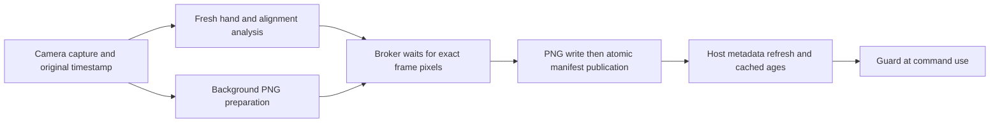

# Camera freshness: current evidence and reliability work

Updated November 24, 2026. **The repeated 600 ms expiry is not solved.** Moving
request/status IO off the UI thread fixed a measured source of blocking, but a
later attended run still expired. Installed 0.260 adds instrumentation and recovery
repairs; it has not passed sustained physical gameplay. See the
[checklist](IntegrationChecklist.md) for exact installed/host identities.

## What the deadline measures

The host evaluates the age of the original camera evidence when it uses it.
600 ms is not a six-tenths-of-a-second image-analysis timer. Camera capture,
delivery, analysis, PNG preparation/publication, file reading and scheduling can
all consume its budget. A worker thread prevents one caller from blocking the UI;
it does not guarantee that new evidence arrives before a deadline.

The current host's metadata-only refresh skips PNG decoding, but still waits for
the broker's image-backed manifest. The native broker has replaceable pending
work; there is no evidence here of an unbounded analysis backlog. Dropping old
work is useful, but the most recent completed evidence can still become stale.

## Measured episode, not a universal latency estimate

The retained 0.259 bedtime run is
[bedtime-play-20261124-023109](</Users/Dave/Documents/SGF PLayer/work/ai-laser-integration/laser-position-recovery-20261123/calibration-acceptance-redesign/gameplay-activation-20261124/bedtime-play-20261124-023109>), with 560 PNGs,
native/host timelines and request/status evidence over 126.9 seconds.

| Interval | Median | p95 | Maximum |
|---|---:|---:|---:|
| Capture → manifest timestamp | 133.2 ms | 170.0 ms | 387.1 ms |
| Safety callback → manifest timestamp | 19.3 ms | 33.6 ms | 237.6 ms |
| Native analysis | 60.1 ms | 67.1 ms | 173.6 ms |
| Main callback delivery | 0.050 ms | — | 16.25 ms |

Analysis queue delay peaked at 8.8 ms. Frame 27830 reached capture age
`0.601021528` seconds at the failing host check; publication age was `0.214029074`
seconds. Nearby status-read/request-write durations were 159.5/136.8 ms. This
supports investigating scheduling/IO contention; it does not identify fsync,
PNG compression or a particular filesystem operation as the proven cause.
Manifest timestamps are sampled before their writes become visible, and the
collector's `observedAt` precedes reads. Do not interpret those as exact visibility
times or apparent future-frame evidence.

A later hand near the right board edge/bowl was a separate conservative clearance
episode, with approximately 127–161 ms delivery. Do not classify all laser stops
as the same timeout or dismiss real hand evidence as noise.

## Changes already installed

- **0.259:** independent bounded background status reads and latest-only request
  writes; original status ages and request expiry retained. F5 was physically
  verified, but the later camera expiry shows this was a partial repair.
- **0.260:** atomic temporary-write/close/rename for ephemeral IPC, bounded image
  retention and trace stages for encode, directory preparation, pruning, pixel
  write and manifest publication. Benchmarks did not establish a speedup.
- **0.260 with host `1ae717e`:** a separate 1.788-second warm handoff had exceeded
  the native 750 ms status freshness limit. Explicit scoped `transitioning`
  reports liveness without inventing dark or first-light evidence. Native bounds
  continuous transitions to three seconds across revision changes. Unrecoverable
  own-game link loss pauses the game/clock; classified camera/lease recovery stays
  available. This repairs handoff semantics, not camera delivery speed.

## Next changes to evaluate — not implemented

1. Publish checked hand/alignment metadata independently of large PNG delivery.
   Preserve original frame/epoch, camera context, verdict and capture timestamps.
   Metadata may establish fresh clearance only for its own observation; it must
   never be paired with older pixels to authorize spot location or recognition.
   Unknown/obstructed/stale observations must revoke permission promptly.
2. Use stage timings to locate tail delays. Consider a bounded socket/shared-memory
   image path only if file delivery is measured as the limiting stage. Transport
   changes need explicit ownership, cancellation, reconnect and loss behavior.
3. Evaluate board regions/frame differences as a work-saving hint, using retained
   lighting, shadows, hands and real moves. “Unchanged” does not make old evidence
   fresh, prove visibility, or substitute for hand/board checks. A smaller workload
   may help CPU cost; it does not alone fix an IO stall.

Before claiming resolution, inject independent stalls into encoding, publication,
reads and UI delivery. Verify stale frames never relight the beam, epoch changes
never mix pixels/verdicts, faults preserve history/clocks, and recovery needs fresh
evidence. Then run a bounded attended game on the requalified setup, retaining
tail-latency/loss data and final full-OFF receipt. No operating-system scheduling
guarantee follows from a passing test. Do not simply increase 600 ms or refresh
timestamps to hide missing evidence.
