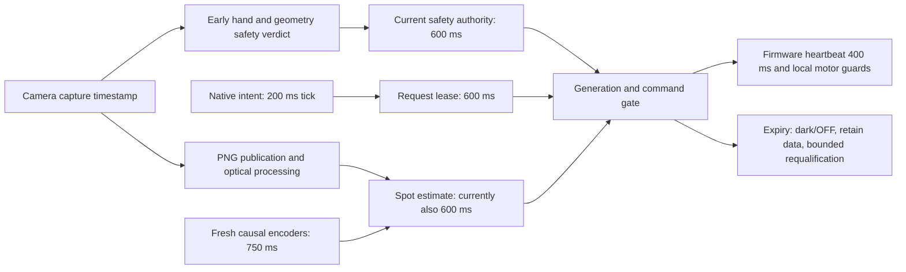

# Temporal requirements audit — November 25, 2026

Several timing requirements are more restrictive than their purpose demands. The best first change is to separate **current permission to illuminate or move** from **how old a still-valid spatial estimate may be**. Increasing every timeout would mix those two questions and leave the underlying failure loops intact.

This is an offline source/evidence audit requested by Dave. It changes no runtime, threshold, installed app, firmware, camera, controller, game or calibration. Root owns physical validation. The root subsequently integrated dark-fit-only repair `511131b`; that separate spatial-policy change does not change the timing inventory. Native source is `fb4697c4ef314d83a253bd0aa219de1bb6b3d61f` (installed 0.268/build269); host source is `bd5a26c4ed20089ccdc7fe2a11c4fb91145fe4fc`; firmware is the existing AimControl v44/PG08 installation, not newly flashed here. Later dark-fit changes are outside this snapshot. The [canonical checklist](/Users/Dave/SGFPlayerClean/PhysicalGo/Documentation/IntegrationChecklist.md) owns current installation and closure.

## Findings and priorities

1. **600 ms conflates several different jobs.** It is the app's command lease, the host's camera safety freshness, an optical result age ceiling, and the recognition inter-frame gap. Those need not share a number. A newly detected hand must invalidate illumination promptly; a spot measured while both motors and board remain stationary need not become geometrically wrong at 601 ms. Preserve separate fresh safety authority, and evaluate a longer, bounded spatial-estimate lifetime only when fresh pose and fixed-anchor geometry establish continuity. Do not relabel old frames as fresh.
2. **Expiring evidence should usually expire authority, not erase useful knowledge.** Darken immediately when needed; preserve target/game/model and valid calibration facts; reacquire within a bounded recovery episode. Current typed stale-camera/lease faults have recovery paths, but geometry/operation faults are generally hard and latch. A fixed time limit causing an optical fault can therefore produce a much larger restart than its original purpose requires.
3. **The app's 12 s cold-admission deadline has no explicit overhead margin over firmware's 12 s engagement deadline.** Native starts when requesting a possible session; firmware starts later when arming. The host command also defaults to 12 s. Equal constants do not describe equal intervals. A native envelope such as 16–20 s is an *experiment hypothesis*, contingent on explicit phase/progress evidence and measured worst-case setup/transport overhead; it must not extend the firmware's engagement permission or silently restart on every retry.
4. **Five/seven-frame spot consensus and repeated 300 ms dark waits are accuracy/settling policies, not fundamental laws.** Five frames at 10 Hz span roughly 400 ms from first to newest, although only the newest frame's age is charged by the final 600 ms test. Processing, geometry and encoder evidence add further time. Compare a short, strong stationary observation with sequential extension for weak cases. Measure the real camera drain/exposure boundary before changing 300 ms; retain causal post-OFF frames.
5. **A fixed geometry age is a revalidation schedule, not proof the board moved.** The old 10 s certificate with 4 s reserve caused dark renewal around 6 s. The new installed lit renewal already addresses this; do not propose it again as absent. Revalidation can remain lit when independent geometry/hand evidence is sufficient. The 53/55/60 s light schedule is separate and still needs physical/endurance rationale before alteration.
6. **The 100 ms serial write timeout includes scheduling and validation.** An elapsed window can exceed 100 ms even when all bytes were written; it is not a measurement of USB blocking. Retrying an already-sent motor command is unsafe/ambiguous. First classify pre-write, partial-write, complete-write and delayed observation separately; preserve command-generation and firmware watchdog fences. Do not 'fix USB' by merely increasing this number.
7. **Long recognition waits can be spatial resets rather than slow processing.** The retained R16 incident had 130 ambiguity resets across 25.418 s, with 122 ms median frame age; the normal 450 ms stability rule did not itself create the 25 s delay. Shortening debounce alone would not cure repeated weak-neighbor ambiguity. Reduce unnecessary whole-board resets while preserving actual placement ambiguity handling.

Most numerical policies below have identifiable code provenance but **no measured system-level derivation** in the inspected artifacts. A test that asserts a number proves implementation consistency, not necessity. Conversely, firmware-enforced limits are real constraints for the installed system even when their original engineering choice deserves later review.

## What the evidence actually says

- Previous attended host `193b10c`, native 0.267: 139 final optical checks passed. The long O17 sequence had 136 checks, capture-age median **252.4 ms**, maximum **401.8 ms**, and **21 programmed dark renewals**. User-reported blinking in that run was not a 600 ms expiry. [Outcome](/Users/Dave/Documents/SGF PLayer/work/feedback-reliability-20261125/attended/outcome.json).
- Earlier single-app host `2f8c4da` had a final optical age **688.84 ms**, then recovered; this is evidence of a deadline failure, not by itself evidence the geometry was wrong. See canonical checklist and its retained run.
- Final installed batch's eight offline lit-renewal replays reached a worst age **553.056 ms** under the 600 ms gate. They inject 180/350 ms incoming lag and mock motor/lease supervision: approximately 47 ms worst margin is not a live tail-latency guarantee. [Replay](/Users/Dave/Documents/SGF PLayer/work/lit-geometry-20261125/final-host-renewal-replay.json).
- Exact live frame1762 dark-registration rejection is spatial: typical residual 0.303 px, p95 1.034 px. Root/registration owner separately repair the gameplay fit policy. This audit does not attribute that rejection to a timer or deploy another fix.
- The R16 recognition interval was 25.418 s / 255 frames, median age122 ms / maximum151 ms, with130 ambiguity resets. That is a freshness-success/decision-instability case, not an image queue backlog diagnosis. [Attribution](/Users/Dave/Documents/SGF PLayer/work/feedback-play-release-20261124/arming-episode-0264/recognition-attribution/attribution-report.txt).

## Active timing inventory

**Disposition:** Keep = retain the invariant/current bound pending specific measurements; Change = strong candidate for a different policy; Investigate = insufficient basis to choose a replacement; UX = presentation/throughput choice, not permission. 'Keep' does not claim a physical derivation. All proposed changes need tests listed below and attended validation where output is involved.

### Camera, native recognition and hand evidence

| ID | Present requirement / source | Purpose and failure consequence | Assessment / proposed treatment |
|---|---|---|---|
| T01 | Capture dispatch **100 ms** during laser guidance; otherwise **200 ms**, or100 ms when a running clock has≤5 s. [CameraProcessingCadence.swift:7](/Users/Dave/SGFPlayerClean-worktrees/lit-geometry-native-20261125/PhysicalGo/Sources/CameraProcessingCadence.swift:7) | Controls compute demand. Missed cadence slots are skipped, not queued. | **Keep/measure.** Already latest-oriented; increasing rate blindly may increase tail age. Separate a cheap safety path from full recognition only if it demonstrates net savings and retains shallow-hand/changed-target sensitivity. |
| T02 | One outstanding camera→main delivery; one replacement preparation job / latest pending broker write. [CameraCapture.swift:201](/Users/Dave/SGFPlayerClean-worktrees/lit-geometry-native-20261125/PhysicalGo/Sources/CameraCapture.swift:201); [CameraAnalysisPipeline.swift:64](/Users/Dave/SGFPlayerClean-worktrees/lit-geometry-native-20261125/PhysicalGo/Sources/CameraAnalysisPipeline.swift:64); [PhysicalLaserFrameBroker.swift:133](/Users/Dave/SGFPlayerClean-worktrees/lit-geometry-native-20261125/PhysicalGo/Sources/PhysicalLaserFrameBroker.swift:133) | Bounds backlog; UI/main-thread stall can still delay delivery. | **Keep invariant.** Test main-thread stalls and disk contention, measure capture→safety and capture→PNG separately. 'Put it on another thread' is already partly implemented. |
| T03 | True presentation timestamp retained even if late; callback fallback is explicit. [CameraFrameTimestamp.swift:8](/Users/Dave/SGFPlayerClean-worktrees/lit-geometry-native-20261125/PhysicalGo/Sources/CameraFrameTimestamp.swift:8) | Prevents making an old image appear fresh. | **Keep.** Never increase reliability by timestamp substitution. For callback cameras commission a measured drain bound or deny relevant hardware admission. |
| T04 | Camera startup **8 s**; lost usable stream **5 s**; restart deadline **9 s**, restart scheduling **750 ms**, health poll **1 s**; retry counter resets after**30 s** healthy. [CameraHealth.swift:12](/Users/Dave/SGFPlayerClean-worktrees/lit-geometry-native-20261125/PhysicalGo/Sources/CameraHealth.swift:12); [CameraCapture.swift:115](/Users/Dave/SGFPlayerClean-worktrees/lit-geometry-native-20261125/PhysicalGo/Sources/CameraCapture.swift:115) | Camera reconnect UX, not laser safety. Laser expires much sooner through separate freshness guards. | **Investigate/keep initially.** Tune using actual device startup distributions; expose 'camera reconnecting' separately from geometry/calibration invalid. These timers should not erase calibration. |
| T05 | Native recognition accepts image age **<1.5 s**; inter-frame gap **>600 ms** resets AI observation streak. [PhysicalAI.swift:558](/Users/Dave/SGFPlayerClean-worktrees/lit-geometry-native-20261125/PhysicalGo/Sources/PhysicalAI.swift:558) | Rejects stale/unknown board observation; gap disallows treating disjoint observations as continuous. | **Change semantics candidate.** Gap can reset a stability streak without invalidating historical board/model. For stationary consistent positions, evaluate fresh independent witnesses across gaps rather than a blanket continuous streak. Keep motion/hand temporal reasoning separate. |
| T06 | AI board/placement requires **≥3 distinct frames spanning≥450 ms**; centering same. [PhysicalAI.swift:467](/Users/Dave/SGFPlayerClean-worktrees/lit-geometry-native-20261125/PhysicalGo/Sources/PhysicalAI.swift:467); [PhysicalAI.swift:672](/Users/Dave/SGFPlayerClean-worktrees/lit-geometry-native-20261125/PhysicalGo/Sources/PhysicalAI.swift:672) | Debounces one-frame errors; changed/ambiguous board resets witnesses. | **Investigate.** At100 ms cadence minimum span normally rounds to500 ms, at200 ms to600 ms. Compare2–3 frames/200–300 ms only for high-confidence legal single-point changes plus fresh clearance; retain longer evidence for ambiguity/capture. Not the main R16 delay. |
| T07 | Human recording stable position / empty board / handicap / capture cleanup / review generally **≥5 frames over≥800 ms**, evidence window/gap **1.5 s**. [GameRecorder.swift:876](/Users/Dave/SGFPlayerClean-worktrees/lit-geometry-native-20261125/PhysicalGo/Sources/GameRecorder.swift:876); [GameRecorder.swift:1233](/Users/Dave/SGFPlayerClean-worktrees/lit-geometry-native-20261125/PhysicalGo/Sources/GameRecorder.swift:1233); [GameRecorder.swift:1500](/Users/Dave/SGFPlayerClean-worktrees/lit-geometry-native-20261125/PhysicalGo/Sources/GameRecorder.swift:1500); [GameRecorder.swift:1937](/Users/Dave/SGFPlayerClean-worktrees/lit-geometry-native-20261125/PhysicalGo/Sources/GameRecorder.swift:1937) | Stronger history/clock evidence and multi-stone cleanup. | **Investigate consistency.** AI and human paths differ. Unify purpose-specific evidence contracts rather than copying the strictest count everywhere. Preserve uncertainty in historical turn timing. |
| T08 | Automatic capture candidate **≥3 frames/≥400 ms**. [GameRecorder.swift:1553](/Users/Dave/SGFPlayerClean-worktrees/lit-geometry-native-20261125/PhysicalGo/Sources/GameRecorder.swift:1553); [GameRecorder.swift:2030](/Users/Dave/SGFPlayerClean-worktrees/lit-geometry-native-20261125/PhysicalGo/Sources/GameRecorder.swift:2030) | Verifies captures before history/clock changes. | **Keep initially.** Compare withT06, and test partial removals, rapid consecutive turns and capture pauses before shortening. |
| T09 | Hand-outline/motion gap **>650 ms** resets tracker; motion fit history≤600 ms; outline clear requires**2 distinct frames**, no separate duration minimum. [HandOutlineTracker.swift:161](/Users/Dave/SGFPlayerClean-worktrees/lit-geometry-native-20261125/PhysicalGo/Sources/HandOutlineTracker.swift:161); [HandOutlineTracker.swift:350](/Users/Dave/SGFPlayerClean-worktrees/lit-geometry-native-20261125/PhysicalGo/Sources/HandOutlineTracker.swift:350); [HandMotionTiming.swift:66](/Users/Dave/SGFPlayerClean-worktrees/lit-geometry-native-20261125/PhysicalGo/Sources/HandMotionTiming.swift:66) | Avoids extrapolating a lost hand indefinitely. Reset yields unknown/reinitialization, not clearance. | **Keep reset→unknown invariant.** Repeated nominally clear after a scheduling gap should reestablish cheaply. Do not replace visual clearance with elapsed time. |
| T10 | Hand background witness at least**500 ms** old, retained≤800 ms. [HandOutlineTracker.swift:226](/Users/Dave/SGFPlayerClean-worktrees/lit-geometry-native-20261125/PhysicalGo/Sources/HandOutlineTracker.swift:226) | Avoids learning the entering hand as background. | **Investigate.** Physical-depth/appearance stability should dominate age. Validate very slow entry and fast shallow edge placement; time-only baseline selection can absorb gradual changes. |
| T11 | Hand disagreement warning after**5 s and10 samples**. [HandOutlineTracker.swift:148](/Users/Dave/SGFPlayerClean-worktrees/lit-geometry-native-20261125/PhysicalGo/Sources/HandOutlineTracker.swift:148) | Diagnostics only; never clears obstruction by waiting. | **UX.** Keep separation; could warn sooner without changing light permission. |
| T12 | Hand motion extrapolation: fit dt**15–500 ms**, predicted exit≤250 ms after last view, estimated error<200 ms; other pose estimator horizon≤400 ms. [HandOutlineTiming.swift:24](/Users/Dave/SGFPlayerClean-worktrees/lit-geometry-native-20261125/PhysicalGo/Sources/HandOutlineTiming.swift:24); [HandMotionTiming.swift:124](/Users/Dave/SGFPlayerClean-worktrees/lit-geometry-native-20261125/PhysicalGo/Sources/HandMotionTiming.swift:124) | Estimates clock hand-exit time, not permission to illuminate. | **Keep scoped.** Do not mistake clock interpolation tolerances for laser clearance. Calibrate against recorded exits if changing. |
| T13 | Alignment failure accumulation **900 ms OR≥3 failures over600 ms**, reset after gap>1.5 s. [BoardAlignmentGate.swift:28](/Users/Dave/SGFPlayerClean-worktrees/lit-geometry-native-20261125/PhysicalGo/Sources/BoardAlignmentGate.swift:28) | Debounces persistent alignment failure. | **Investigate.** A brief poor frame should make current evidence unknown, not permanently reset geometry. True coherent shift should request bounded re-registration. |
| T14 | Board recovery feedback requires**5 clear frames/1 s**, gap reset1.5 s. [BoardViewRecoveryFeedback.swift:23](/Users/Dave/SGFPlayerClean-worktrees/lit-geometry-native-20261125/PhysicalGo/Sources/BoardViewRecoveryFeedback.swift:23) | UI recovery acknowledgement. | **UX.** Can be slower than underlying permission; message must not remain an apparent obstruction after accepted move. |
| T15 | Established-stone rescan **500 ms**. [EstablishedStoneTracker.swift:31](/Users/Dave/SGFPlayerClean-worktrees/lit-geometry-native-20261125/PhysicalGo/Sources/EstablishedStoneTracker.swift:31) | Reduces recognition work on unchanged stones. | **Keep/measure.** Target-local additions/captures must bypass inappropriate caching. This is a more concrete optimization than whole-frame diff gates that missed dependencies. |
| T16 | Checking-help appears after**3 fresh frames and3 s**, refresh≤1 Hz. [PhysicalAICheckingProgress.swift:48](/Users/Dave/SGFPlayerClean-worktrees/lit-geometry-native-20261125/PhysicalGo/Sources/PhysicalAICheckingProgress.swift:48) | Explains indefinite checking; does not fix/reset recognition. | **UX keep.** Distinguish explanatory timer from admission timeout. Add actionable reason/affected cells; do not imply 'wait longer' solves persistent ambiguity. |
| T17 | Human recorder attention **3 s** conflict / **10 s** settling; unresolved deferral**12 s**; blocked-view alert≥5 samples/10 s. [GameRecorder.swift:1068](/Users/Dave/SGFPlayerClean-worktrees/lit-geometry-native-20261125/PhysicalGo/Sources/GameRecorder.swift:1068); [GameRecorder.swift:1855](/Users/Dave/SGFPlayerClean-worktrees/lit-geometry-native-20261125/PhysicalGo/Sources/GameRecorder.swift:1855); [GameRecorder.swift:2789](/Users/Dave/SGFPlayerClean-worktrees/lit-geometry-native-20261125/PhysicalGo/Sources/GameRecorder.swift:2789) | Escalates uncertainty without inventing moves. | **UX/investigate.** Retain history uncertainty, but offer earlier bounded recovery instead of indefinite stalls. No need to wait10 s before diagnosing a clear persistent fault. |

### Native bridge, leases and recovery

| ID | Present requirement / source | Purpose and failure consequence | Assessment / proposed treatment |
|---|---|---|---|
| T18 | Native bridge tick**200 ms**, request lease**600 ms**; host parser permits lease length≤700 ms. [PhysicalLaserGuidance.swift:268](/Users/Dave/SGFPlayerClean-worktrees/lit-geometry-native-20261125/PhysicalGo/Sources/PhysicalLaserGuidance.swift:268); [PhysicalLaserGuidance.swift:826](/Users/Dave/SGFPlayerClean-worktrees/lit-geometry-native-20261125/PhysicalGo/Sources/PhysicalLaserGuidance.swift:826); [bridge_lease.py:55](/Users/Dave/DYNAMIXEL-Go-Pointer-worktrees/lit-geometry-integration-20261125/Firmware/bridge_lease.py:55) | Revokes authority if producer stops; stale request latches cancelled revision/fullOFF. | **Investigate distinct lease budget.** Three nominal ticks leave limited scheduler/disk margin. Candidate800–1000 ms lease only after end-to-end stale-intent bound is justified; independent camera/firmware guards must remain. Prefer producer progress heartbeat off the UI bottleneck with immutable decision snapshot and explicit cancellation. |
| T19 | Request read/status publish loop**40 ms**; lease watchdog**20 ms**. [bridge_runtime.py:194](/Users/Dave/DYNAMIXEL-Go-Pointer-worktrees/lit-geometry-integration-20261125/Firmware/bridge_runtime.py:194); [bridge_lease.py:358](/Users/Dave/DYNAMIXEL-Go-Pointer-worktrees/lit-geometry-integration-20261125/Firmware/bridge_lease.py:358) | Timely receipt/expiry; watchdog independent of optical worker. | **Keep independent ownership.** More polling isn't a cure for blocked filesystem; latest snapshots and deadline telemetry matter. |
| T20 | Separate read/write queues, at most one pending request; timestamps are not renewed by queue processing. [LatestFileExchange.swift:5](/Users/Dave/SGFPlayerClean-worktrees/lit-geometry-native-20261125/PhysicalGo/Sources/LatestFileExchange.swift:5) | Prevents file IO blocking main thread and old requests accumulating. | **Keep.** Already installed, so audit future stalls at actual queue/capture/write boundaries rather than reimplementing this. |
| T21 | Native driver status age**<750 ms**; thermal age plus status age≤750 ms. [PhysicalLaserGuidance.swift:36](/Users/Dave/SGFPlayerClean-worktrees/lit-geometry-native-20261125/PhysicalGo/Sources/PhysicalLaserGuidance.swift:36); [PhysicalLaserGuidance.swift:650](/Users/Dave/SGFPlayerClean-worktrees/lit-geometry-native-20261125/PhysicalGo/Sources/PhysicalLaserGuidance.swift:650) | Rejects lost driver/thermal reports; can latch motor fault/pause. | **Keep initially, measure publication budget.** Actual thermal safety is already firmware-enforced. Status transport lag should be classified separately from absent underlying telemetry. |
| T22 | Native clear/empty evidence**<1.5 s**; motor admission camera age**<700 ms**. [PhysicalLaserGuidance.swift:652](/Users/Dave/SGFPlayerClean-worktrees/lit-geometry-native-20261125/PhysicalGo/Sources/PhysicalLaserGuidance.swift:652); [PhysicalLaserGuidance.swift:764](/Users/Dave/SGFPlayerClean-worktrees/lit-geometry-native-20261125/PhysicalGo/Sources/PhysicalLaserGuidance.swift:764) | Allows native intent; host independently insists on newer600 ms evidence. | **Investigate consistency.** Current intersection of700/600/1500 means tightening one may merely increase churn. Assign distinct roles: state evidence, safety evidence, and intent. |
| T23 | Cold native admission**12 s**; firmware engagement**12 s**; host admission command**12 s**. [PhysicalMotorAdmission.swift:45](/Users/Dave/SGFPlayerClean-worktrees/lit-geometry-native-20261125/PhysicalGo/Sources/PhysicalMotorAdmission.swift:45); [bridge_gameplay.py:178](/Users/Dave/DYNAMIXEL-Go-Pointer-worktrees/lit-geometry-integration-20261125/Firmware/bridge_gameplay.py:178); [AimControl.ino:104](/Users/Dave/DYNAMIXEL-Go-Pointer-worktrees/lit-geometry-integration-20261125/Firmware/AimControl/AimControl.ino:104) | Incomplete cold admission becomes hard fault. Starts are not synchronized. | **Change candidate, high priority.** Preserve firmware12 s; measure pre-arm/IO overhead and create progress-bounded outer envelope.16–20 s is a trial range only, not a proven safe default. Retain one episode origin across revisions. |
| T24 | Native warm transition**3 s** vs host dark-state confirmation**2 s**. [PhysicalMotorAdmission.swift:48](/Users/Dave/SGFPlayerClean-worktrees/lit-geometry-native-20261125/PhysicalGo/Sources/PhysicalMotorAdmission.swift:48); [bridge_gameplay.py:211](/Users/Dave/DYNAMIXEL-Go-Pointer-worktrees/lit-geometry-integration-20261125/Firmware/bridge_gameplay.py:211) | Bounds quiescence and actual stationary dark state; failure can latch/pause. | **Investigate margins.** Current completion fence fixed a race; don't undo it. Determine whether2 s includes thermal pair, query and publication, and leave explicit outer margin. |
| T25 | Recovery requires≥3 clear frames/≥450 ms, each age**<500 ms**, gaps≤600 ms, causal after authenticatedOFF. [PhysicalGuidanceRecovery.swift:89](/Users/Dave/SGFPlayerClean-worktrees/lit-geometry-native-20261125/PhysicalGo/Sources/PhysicalGuidanceRecovery.swift:89); [PhysicalGuidanceRecovery.swift:120](/Users/Dave/SGFPlayerClean-worktrees/lit-geometry-native-20261125/PhysicalGo/Sources/PhysicalGuidanceRecovery.swift:120); [PhysicalLaserGuidance.swift:360](/Users/Dave/SGFPlayerClean-worktrees/lit-geometry-native-20261125/PhysicalGo/Sources/PhysicalLaserGuidance.swift:360) | Prevents immediate relight on same stale/obstructed evidence. | **Investigate duplicated streaks.** Reuse one authenticated fresh witness stream for recovery and target verification; do not force serial independent450 ms windows when they prove same fact. Never count duplicates or renew oldOFF. |
| T26 | Post-OFF frame capture must be≥ **300 ms** after acknowledgedOFF; callback fallback needs measured bound≥300 ms. [PhysicalLaserGuidance.swift:444](/Users/Dave/SGFPlayerClean-worktrees/lit-geometry-native-20261125/PhysicalGo/Sources/PhysicalLaserGuidance.swift:444); [PhysicalLaserGuidance.swift:537](/Users/Dave/SGFPlayerClean-worktrees/lit-geometry-native-20261125/PhysicalGo/Sources/PhysicalLaserGuidance.swift:537) | Avoids interpreting laser-lit buffered exposure as stone. | **Change only after measurement.** Presentation timestamps may allow exposure-end/transition-aware drain instead of a fixed300 ms. Test worst exposure/buffering and rolling shutter. Command acknowledgment alone isn't optical extinction. |
| T27 | Classified camera/lease transients can recover; optical/setup/transport/controller faults hard-latch. [bridge_errors.py:17](/Users/Dave/DYNAMIXEL-Go-Pointer-worktrees/lit-geometry-integration-20261125/Firmware/bridge_errors.py:17); [bridge_runtime.py:100](/Users/Dave/DYNAMIXEL-Go-Pointer-worktrees/lit-geometry-integration-20261125/Firmware/bridge_runtime.py:100) | Prevents blind repeats after potentially invalid geometry/control. | **Change classification candidate.** Preserve immediate dark/OFF action, but distinguish 'fresh data unavailable' and 'small coherent geometry change requiring requalification' from proven unsafe setup. One bounded recovery episode, no endless rearm. |

### Optical work and motion orchestration

| ID | Present requirement / source | Purpose and failure consequence | Assessment / proposed treatment |
|---|---|---|---|
| T28 | Host frame read age≤ **600 ms** on capture uptime, arrival uptime, capture wall time, publication wall time. [bridge_frames.py:64](/Users/Dave/DYNAMIXEL-Go-Pointer-worktrees/lit-geometry-integration-20261125/Firmware/bridge_frames.py:64) | Ensures a fresh source and rejects future/inconsistent timestamps. | **Keep safety role, separate spatial role.** Multiple clocks detect inconsistencies but wall-clock adjustment deserves explicit tests; don't independently extend each deadline or substitute publication time for capture. |
| T29 | Gameplay cached safety age≤ **600 ms**, including time since metadata read. [bridge_gameplay.py:132](/Users/Dave/DYNAMIXEL-Go-Pointer-worktrees/lit-geometry-integration-20261125/Firmware/bridge_gameplay.py:132) | Cheap no-IO check under command locks; stops active operation on stale/hand evidence. | **Keep current bound pending response-time study.** The historical250 ms calibration cache is not this path. File refresh now runs separately; repeated setup hashing should be cached per immutable admission, not read at50 Hz merely to prove freshness. |
| T30 | Optical-result newest frame age≤ **600 ms after image processing and causal encoder proof**, again at publication/renewal. [bridge_feedback.py:326](/Users/Dave/DYNAMIXEL-Go-Pointer-worktrees/lit-geometry-integration-20261125/Firmware/bridge_feedback.py:326); [bridge_feedback.py:359](/Users/Dave/DYNAMIXEL-Go-Pointer-worktrees/lit-geometry-integration-20261125/Firmware/bridge_feedback.py:359); [bridge_optical_geometry.py:182](/Users/Dave/DYNAMIXEL-Go-Pointer-worktrees/lit-geometry-integration-20261125/Firmware/bridge_optical_geometry.py:182) | Prevents steering from a pose/spot that may have changed; currently uses same number as safety. | **Change candidate, highest priority.** Evaluate750 ms/1 s/1.5 s bounded spatial result lifetimes *only* with current independent hand/geometry/pose continuity and no intervening command. Freshness is an error/continuity condition, not elapsed time alone. No relight if fresh safety channel is stale. |
| T31 | Collect**5 spot frames**, extend to7 if consensus fails; experimental2-frame correction is not current feedback-first path. Each batch wait≤ **5 s**. [bridge_hardware.py:200](/Users/Dave/DYNAMIXEL-Go-Pointer-worktrees/lit-geometry-integration-20261125/Firmware/bridge_hardware.py:200) | Suppresses noise/glare, requires newest frame support; registration failure is fatal. | **Change candidate.** Sequential strong evidence2–3 frames, extending5/7 when needed; preserve newest-frame and independent visibility checks. Compare false-spot rate and aiming time on retained/live data. Batch temporal extent must be reported separately from newest age. |
| T32 | Exactly**3 dark source frames** form median; qualified geometry age counts from oldest capture. [bridge_optical_geometry.py:27](/Users/Dave/DYNAMIXEL-Go-Pointer-worktrees/lit-geometry-integration-20261125/Firmware/bridge_optical_geometry.py:27); [bridge_optical_geometry.py:48](/Users/Dave/DYNAMIXEL-Go-Pointer-worktrees/lit-geometry-integration-20261125/Firmware/bridge_optical_geometry.py:48) | Robust baseline and causal age, but fitting time consumes certificate life. | **Investigate.** Maintain timestamp provenance. Allow current validation to renew a separate geometry certificate rather than dating the whole model by oldest dark pixel. Already partially done in lit renewal. |
| T33 | Geometry certificate**10 s**, refresh reserve**4 s** → starts around6 s. [bridge_optical_geometry.py:24](/Users/Dave/DYNAMIXEL-Go-Pointer-worktrees/lit-geometry-integration-20261125/Firmware/bridge_optical_geometry.py:24) | Bounds continued trust; original behavior regularly darkened beam. | **Change schedule semantics, already partly installed.** Lit fixed-anchor revalidation now renews certificate; original dark baseline remains immutable. Evaluate need for fixed age in presence of continuously passing geometry rather than merely increasing10. |
| T34 | Lit supplemental proof CPU budget**100 ms**; alias repair budget**100 ms**,≤32 repairs. [bridge_lit_geometry.py:20](/Users/Dave/DYNAMIXEL-Go-Pointer-worktrees/lit-geometry-integration-20261125/Firmware/bridge_lit_geometry.py:20); [bridge_correspondence.py:22](/Users/Dave/DYNAMIXEL-Go-Pointer-worktrees/lit-geometry-integration-20261125/Firmware/bridge_correspondence.py:22) | Bounds extra work inside tight result window; optional proof failure falls back dark, ordinary geometry failure remains fatal. | **Investigate/replace with remaining budget.** FixedCPU deadline may be machine-load dependent. Use explicit remaining operation budget and bounded work, record fallback cause. Never spend old frame's remaining authority while assuming it renews itself. |
| T35 | Host light bound **55 s**, proactive renewal **53 s**, firmware SWEEP **60 s**. [bridge_feedback.py:35](/Users/Dave/DYNAMIXEL-Go-Pointer-worktrees/lit-geometry-integration-20261125/Firmware/bridge_feedback.py:35); [AimControl.ino:21](/Users/Dave/DYNAMIXEL-Go-Pointer-worktrees/lit-geometry-integration-20261125/Firmware/AimControl/AimControl.ino:21) | Host margin before firmware’s actual continuous-sweep cap; geometry renewal does not reset light origin. | **Keep installed firmware limit; investigate its purpose.** These are not all measured thermal limits. Characterize the laser/driver continuous-output rating and sustained behavior before altering 60 s. First reduce interruptions within this contract. |
| T36 | DARK command reply ≤ **3 s**, then **300 ms** before source capture. [bridge_feedback.py:181](/Users/Dave/DYNAMIXEL-Go-Pointer-worktrees/lit-geometry-integration-20261125/Firmware/bridge_feedback.py:181) | Confirms dark transition and camera drain. | **Investigate latency.** Positive extinction/frame evidence may replace the fixed wait. Command timeout is an outer bound, not a mandatory sleep. |
| T37 | Fresh prelight causal encoders: wait ≤ **2 s**, evidence age ≤ **750 ms**. [bridge_feedback.py:292](/Users/Dave/DYNAMIXEL-Go-Pointer-worktrees/lit-geometry-integration-20261125/Firmware/bridge_feedback.py:292) | Confirms actual pose after PREPARE. | **Keep causal ordering; measure cost.** Current implementation uses streaming telemetry. A 2 s wait does not authorize stale camera evidence. |
| T38 | Post-image encoder proof after max(image capture, pre-image POSE completion); polls **5 ms**, stops at **600 ms** image age. [bridge_feedback.py:311](/Users/Dave/DYNAMIXEL-Go-Pointer-worktrees/lit-geometry-integration-20261125/Firmware/bridge_feedback.py:311) | Proves stationary measured pose; old SETTLED is insufficient. | **Keep causality; revise the shared deadline with T30.** Streaming proof already replaced an expensive post-processing POSE round trip. Do not propose that earlier optimization as missing. |
| T39 | Target approach ≤ **150 s** and ≤ **25 moves**; GOTO ≤10 s, fine axes ≤11 s, additionally clipped by geometry/light budgets. [bridge_feedback.py:33](/Users/Dave/DYNAMIXEL-Go-Pointer-worktrees/lit-geometry-integration-20261125/Firmware/bridge_feedback.py:33); [bridge_feedback.py:476](/Users/Dave/DYNAMIXEL-Go-Pointer-worktrees/lit-geometry-integration-20261125/Firmware/bridge_feedback.py:476); [bridge_feedback.py:555](/Users/Dave/DYNAMIXEL-Go-Pointer-worktrees/lit-geometry-integration-20261125/Firmware/bridge_feedback.py:555) | Finite supervision, not desired play speed. | **Keep a finite bound; improve control and UX.** Track lack of progress separately. Reserve a correction allowance within the original episode rather than restarting 150 s after each interruption. An upper bound is not itself a delay. |
| T40 | Held spot outside **0.20 cell** immediately becomes an optical fault. [bridge_feedback.py:605](/Users/Dave/DYNAMIXEL-Go-Pointer-worktrees/lit-geometry-integration-20261125/Firmware/bridge_feedback.py:605) | A spatial threshold causes a temporal consequence: stop rather than correct. | **Change candidate with the spatial audit.** Re-enter bounded correction for a fresh, safely contained, uniquely assigned spot. Add acquisition/hold hysteresis and preserve the original episode deadline. Hand, unknown visibility and escaped pose still require dark/OFF. |
| T41 | Prepared alignment wait ≤ **4 s**; reuse ≤ **10 s**; background preparation polls **100 ms**. [bridge_hardware.py:403](/Users/Dave/DYNAMIXEL-Go-Pointer-worktrees/lit-geometry-integration-20261125/Firmware/bridge_hardware.py:403); [bridge_alignment.py:69](/Users/Dave/DYNAMIXEL-Go-Pointer-worktrees/lit-geometry-integration-20261125/Firmware/bridge_alignment.py:69); [bridge_runtime.py:205](/Users/Dave/DYNAMIXEL-Go-Pointer-worktrees/lit-geometry-integration-20261125/Firmware/bridge_runtime.py:205) | Overlaps dark registration with AI thinking. | **Investigate reuse rate and misses.** Accept current validated geometry when available; never extend old pixels blindly. Record why prepared results are discarded. |

### Transport and installed firmware

| ID | Present requirement / source | Purpose and failure consequence | Assessment / proposed treatment |
|---|---|---|---|
| T42 | Host serial write window **100 ms**, writable waits in **10 ms** slices; starts after acquiring writer lock, includes validation and post-return check. [point_session.py:30](/Users/Dave/DYNAMIXEL-Go-Pointer-worktrees/lit-geometry-integration-20261125/Firmware/point_session.py:30) | A hard transport fault may occur after bytes were already sent. | **Investigate, high priority.** Distinguish lock wait, validation, bytes accepted and observation delay. Never retry an ambiguous complete command. Bound intent at actual dispatch and label scheduler overrun truthfully. |
| T43 | Host heartbeat every **80 ms**, receiver select ≤20 ms; firmware expiry **400 ms**. [point_session.py:116](/Users/Dave/DYNAMIXEL-Go-Pointer-worktrees/lit-geometry-integration-20261125/Firmware/point_session.py:116); [AimControl.ino:113](/Users/Dave/DYNAMIXEL-Go-Pointer-worktrees/lit-geometry-integration-20261125/Firmware/AimControl/AimControl.ino:113) | Hardware stops after host loss; receiver/GIL/writer contention can affect cadence. | **Keep 400 ms pending an explicit response budget.** Isolate deterministic supervision rather than mask starvation. Physical response includes capture, authority lifetime, scheduling and firmware; it is not simply 400 ms. |
| T44 | Serial startup DTR wait **150 ms**, STATUS ≤2 s; generic command ≤10 s, move ≤11 s. [point_session.py:22](/Users/Dave/DYNAMIXEL-Go-Pointer-worktrees/lit-geometry-integration-20261125/Firmware/point_session.py:22); [point_session.py:141](/Users/Dave/DYNAMIXEL-Go-Pointer-worktrees/lit-geometry-integration-20261125/Firmware/point_session.py:141) | Startup and bounded reply handling. | **Investigate startup if failures are observed.** Prefer positive ready identity to a fixed delay where possible. Never replay a motor command merely because its reply timed out. |
| T45 | Full OFF confirmation ≤ **2 s**: fresh OFF/DONE followed by fresh STATUS. [bridge_off.py:20](/Users/Dave/DYNAMIXEL-Go-Pointer-worktrees/lit-geometry-integration-20261125/Firmware/bridge_off.py:20) | Timeout means OFF unconfirmed, not proof the beam remains on. | **Keep causal receipt and bounded wait.** An additional diagnostic receipt wait must not extend active authority or fabricate an OFF result. |
| T46 | Dynamixel register receive timeout ≤ **30 ms**. [CheckedDynamixel.h:20](/Users/Dave/DYNAMIXEL-Go-Pointer-worktrees/lit-geometry-integration-20261125/Firmware/AimControl/CheckedDynamixel.h:20) | Bounds bus transactions; missing/invalid reply faults. | **Keep installed bus bound.** Measure transaction tails before changing. Raising it multiplies 14-register thermal acquisition and can starve pose/heartbeat deadlines. |
| T47 | Motor watchdog register98 = **10 units** (source describes a **200 ms** watchdog); poseFresh ≤ **200 ms**. [AimControl.ino:68](/Users/Dave/DYNAMIXEL-Go-Pointer-worktrees/lit-geometry-integration-20261125/Firmware/AimControl/AimControl.ino:68); [AimControl.ino:297](/Users/Dave/DYNAMIXEL-Go-Pointer-worktrees/lit-geometry-integration-20261125/Firmware/AimControl/AimControl.ino:297) | Bus-loss protection and current pose authority. | **Keep current installed constraint.** Firmware alternates axis reads to avoid starvation. Confirm register units against pinned device documentation before firmware changes; this audit does not independently certify that external specification. |
| T48 | Thermal service trigger ≥ **100 ms** when eligible, or immediately for the requested pair; sample/report age ≤ **750 ms**. [AimControl.ino:150](/Users/Dave/DYNAMIXEL-Go-Pointer-worktrees/lit-geometry-integration-20261125/Firmware/AimControl/AimControl.ino:150); [GameplaySupervision.h:30](/Users/Dave/DYNAMIXEL-Go-Pointer-worktrees/lit-geometry-integration-20261125/Firmware/AimControl/GameplaySupervision.h:30); [bridge_thermal.py:34](/Users/Dave/DYNAMIXEL-Go-Pointer-worktrees/lit-geometry-integration-20261125/Firmware/bridge_thermal.py:34) | Fresh position, torque, current, voltage and temperature, not temperature alone. | **Keep until split by field.** Thermal inertia does not justify older pose/torque evidence. Separate field rates only after causal protocol tests. |
| T49 | Firmware thermal ACK timeout **1500 ms**; host bootstrap **12 s**, then complete pair age ≤750 ms. [AimControl.ino:105](/Users/Dave/DYNAMIXEL-Go-Pointer-worktrees/lit-geometry-integration-20261125/Firmware/AimControl/AimControl.ino:105); [bridge_thermal.py:157](/Users/Dave/DYNAMIXEL-Go-Pointer-worktrees/lit-geometry-integration-20261125/Firmware/bridge_thermal.py:157) | Checks that the host consumes actual telemetry. | **Keep causal ACK.** Review staged-report/backpressure budget and bootstrap start alignment with T23. Do not ACK cached headers as new samples. |
| T50 | Sustained motor-speed fault after **120 ms**; idle monitor interval **30 ms**. [AimControl.ino:220](/Users/Dave/DYNAMIXEL-Go-Pointer-worktrees/lit-geometry-integration-20261125/Firmware/AimControl/AimControl.ino:220); [AimControl.ino:657](/Users/Dave/DYNAMIXEL-Go-Pointer-worktrees/lit-geometry-integration-20261125/Firmware/AimControl/AimControl.ino:657) | Distinguishes transient encoder noise from ongoing movement. | **Investigate physical noise versus response requirements.** Retain current bound without measurements of servo/stand oscillation and beam containment. |
| T51 | Initial hold quiet duration: fast **300 ms**, legacy **2 s**; overall settle ≤ **8 s**. [AimControl.ino:314](/Users/Dave/DYNAMIXEL-Go-Pointer-worktrees/lit-geometry-integration-20261125/Firmware/AimControl/AimControl.ino:314) | Gameplay cold admission begins with legacy stationary/hold, then enables fast mode. | **Investigate startup cost.** Measure optical and encoder drift after shorter windows. Motor quiet can miss flexible-stand motion. Retain the hard 8 s bound until evidence supports a replacement. |
| T52 | Movement stable window: fast/bench **150 ms**, corner **300 ms**, legacy **2 s**; operation ≤ **8 s**. Fine deadband requires ≥300 ms. [AimControl.ino:368](/Users/Dave/DYNAMIXEL-Go-Pointer-worktrees/lit-geometry-integration-20261125/Firmware/AimControl/AimControl.ino:368); [AimControl.ino:424](/Users/Dave/DYNAMIXEL-Go-Pointer-worktrees/lit-geometry-integration-20261125/Firmware/AimControl/AimControl.ino:424); [AimControl.ino:437](/Users/Dave/DYNAMIXEL-Go-Pointer-worktrees/lit-geometry-integration-20261125/Firmware/AimControl/AimControl.ino:437); [AimControl.ino:453](/Users/Dave/DYNAMIXEL-Go-Pointer-worktrees/lit-geometry-integration-20261125/Firmware/AimControl/AimControl.ino:453) | Control-profile settling rather than host prediction accuracy. | **Investigate adaptive settling.** Match duration to optical/encoder stability and distance. Eight seconds is a maximum, not mandatory delay; faster movement must retain overshoot and board-edge containment. |
| T53 | Cooling stays below 40°C for **30 s** before eligibility; reheating resets dwell. [GameplaySupervision.h:93](/Users/Dave/DYNAMIXEL-Go-Pointer-worktrees/lit-geometry-integration-20261125/Firmware/AimControl/GameplaySupervision.h:93) | Hysteresis while motors are released; warm and trip thresholds are separate. | **Keep now; characterize.** No physical derivation of 30 s was found. Evaluate measured cooling/reheat curves instead of treating the dwell as a fundamental law. |
| T54 | Legacy arm **20 s**, dual session **120 s**; SPOT **250 ms**, PEEK **4 s**, AIM **10 s**; distinct MARK/TRACK sentinel modes; gameplay protocol range **99,999,999 ms**. [AimControl.ino:21](/Users/Dave/DYNAMIXEL-Go-Pointer-worktrees/lit-geometry-integration-20261125/Firmware/AimControl/AimControl.ino:21); [AimControl.ino:26](/Users/Dave/DYNAMIXEL-Go-Pointer-worktrees/lit-geometry-integration-20261125/Firmware/AimControl/AimControl.ino:26); [AimControl.ino:32](/Users/Dave/DYNAMIXEL-Go-Pointer-worktrees/lit-geometry-integration-20261125/Firmware/AimControl/AimControl.ino:32); [AimControl.ino:103](/Users/Dave/DYNAMIXEL-Go-Pointer-worktrees/lit-geometry-integration-20261125/Firmware/AimControl/AimControl.ino:103) | Mode-specific contracts; current gameplay uses supervised v44/SWEEP. | **Keep mode distinctions.** Do not import legacy arm limits into long games or treat sentinels as permission for unsupervised output. Protocol range is a representation bound, not a desired session limit. |

### Calibration, launcher, diagnostic and non-permission timing

| ID | Present requirement / source | Purpose and failure consequence | Assessment / proposed treatment |
|---|---|---|---|
| T55 | Launcher: **3** fresh checks before READY and **3** after; each new-frame wait ≤ **600 ms**. [Tools/launch_reviewed_feedback.py:108](/Users/Dave/DYNAMIXEL-Go-Pointer-worktrees/lit-geometry-integration-20261125/Firmware/Tools/launch_reviewed_feedback.py:108) | Revalidates without opening the controller. | **Change candidate.** A robust multi-frame fit plus fresh post-READY identity/clearance may replace six independent opportunities for marginal failure. Capture exact failures; do not silently retry until something passes. |
| T56 | Calibration permit cache **250 ms**, explicit experiment **250–500 ms**; camera default **600 ms**, experiment ≤ **10 s**; lease remains **600 ms**. [Tools/commission_gameplay_dark.py:34](/Users/Dave/DYNAMIXEL-Go-Pointer-worktrees/lit-geometry-integration-20261125/Firmware/Tools/commission_gameplay_dark.py:34); [Tools/commission_gameplay_calibration.py:1663](/Users/Dave/DYNAMIXEL-Go-Pointer-worktrees/lit-geometry-integration-20261125/Firmware/Tools/commission_gameplay_calibration.py:1663) | Commissioning supervisor, not the current gameplay cache. | **Change architecture candidate.** Preserve saved measurements on cache loss. Separate fresh safety from slower geometry work. The 10 s experimental camera policy is not automatically suitable for gameplay or hand protection. |
| T57 | Calibration analysis ≤ **3 s**, geometry lifetime **5 s**, fresh proof ≤ **2 s**, final optical ticket **150 ms**. [Tools/commission_gameplay_calibration.py:57](/Users/Dave/DYNAMIXEL-Go-Pointer-worktrees/lit-geometry-integration-20261125/Firmware/Tools/commission_gameplay_calibration.py:57); [Tools/commission_gameplay_calibration.py:1726](/Users/Dave/DYNAMIXEL-Go-Pointer-worktrees/lit-geometry-integration-20261125/Firmware/Tools/commission_gameplay_calibration.py:1726) | Stage-specific finite authority; overrun pauses. | **Investigate compounded budgets.** Analysis may consume most lifetime before proof; dispatch scheduling may consume a 150 ms ticket. Preserve causal boundaries and distinguish off-only computation from illumination authority. |
| T58 | Calibration default run **600 s**, normal **60–900 s**, experiment ≤ **7200 s**; target default **120 s**, experimental target timer may be disabled. [Tools/commission_gameplay_calibration.py:2198](/Users/Dave/DYNAMIXEL-Go-Pointer-worktrees/lit-geometry-integration-20261125/Firmware/Tools/commission_gameplay_calibration.py:2198) | Attended experiment bounds, not precision requirements. | **Change workflow.** Minimal calibration and saved checkpoints should avoid long tours. Preserve valid points when time expires; separate human waiting from energized time without renewing physical permission. |
| T59 | Recovery waits for clear OFF ≤ **10 s**, fresh dark frame ≤ **10 s**; original target/run deadlines retained. Coordinator polls **250 ms**, terminate wait **10 s**, kill wait **5 s**. [Tools/commission_gameplay_calibration.py:1892](/Users/Dave/DYNAMIXEL-Go-Pointer-worktrees/lit-geometry-integration-20261125/Firmware/Tools/commission_gameplay_calibration.py:1892); [calibration_recovery_coordinator.py:48](/Users/Dave/DYNAMIXEL-Go-Pointer-worktrees/lit-geometry-integration-20261125/Firmware/calibration_recovery_coordinator.py:48) | Bounded continuation and shutdown. | **Keep finite origin; improve classification.** A hand or unavailable view can pause without erasing measured points. Verify actual OFF before continuation. |
| T60 | Dark commissioning hold **10 s**, resume **2 s**, total **40 s**; bounded ranges ≤15/5/45 s. [Tools/commission_gameplay_dark.py:407](/Users/Dave/DYNAMIXEL-Go-Pointer-worktrees/lit-geometry-integration-20261125/Firmware/Tools/commission_gameplay_dark.py:407) | Specific smoke-test protocol. | **Keep as test only.** Do not infer production hold durations or timeouts from a fixture’s test duration. |
| T61 | AI search-result wait **90 s**, polling **20 ms** with a reused worker or **200 ms** otherwise. [PhysicalAI.swift:907](/Users/Dave/SGFPlayerClean-worktrees/lit-geometry-native-20261125/PhysicalGo/Sources/PhysicalAI.swift:907) | Engine completion/recovery, not optical permission. | **Investigate only for engine hangs.** Retained AI reply was about 495 ms after board confirmation; no evidence that the 90 s limit caused current delay. |
| T62 | Clock display **500 ms**; audio beeps **45/70/300 ms**, speech fallback **1.5 s**; diagnostic before/after **4/5 s**, trace flush **1 s**. [PhysicalAIClockView.swift:38](/Users/Dave/SGFPlayerClean-worktrees/lit-geometry-native-20261125/PhysicalGo/Sources/PhysicalAIClockView.swift:38); [LocalClockAudio.swift:132](/Users/Dave/SGFPlayerClean-worktrees/lit-geometry-native-20261125/PhysicalGo/Sources/LocalClockAudio.swift:132); [DiagnosticSettings.swift:9](/Users/Dave/SGFPlayerClean-worktrees/lit-geometry-native-20261125/PhysicalGo/Sources/DiagnosticSettings.swift:9); [AIRecognitionTrace.swift:17](/Users/Dave/SGFPlayerClean-worktrees/lit-geometry-native-20261125/PhysicalGo/Sources/AIRecognitionTrace.swift:17) | Presentation and retention, not movement authority. | **Keep off critical paths.** Click dispatch already waits for accepted illuminated status and deduplicates per move. Dispatch timestamps do not establish actual audio onset. |
| T63 | Repeated camera buffer: ≥ **4 repeats over 1.5 s**; severe blur: ≥ **3 frames over 800 ms**; gap > **2 s** resets assessment. [CameraFeedHealth.swift:44](/Users/Dave/SGFPlayerClean-worktrees/lit-geometry-native-20261125/PhysicalGo/Sources/CameraFeedHealth.swift:44) | Detects frozen/placeholder content despite advancing timestamps; triggers reconnect. | **Keep content-health check.** Distinguish exact repeated buffers from a stationary live board. Validate device compression/repeat behavior; timestamps alone do not prove liveness. |

## Deadline composition and failure semantics

The drawing separates concepts; the proposed softer recovery box is not a claim that every current fault already behaves that way. Current hard optical/setup/transport/controller faults can latch and pause the game. A request renewal does not renew a frame; newly written status does not renew thermal samples; a new geometry certificate does not reset the original SWEEP time. Preserve these causal invariants.

A 600 ms camera deadline is **not** a demonstrated 600 ms maximum hand-to-light-OFF response. Actual response includes capture cadence/exposure, hand detection latency, native/host publication, cancellation/serial write and firmware scheduling. Derive a response budget from measurements before describing a particular number as safe. Conversely, CPU work taking 650 ms does not itself prove a stationary target became wrong.

Current five-frame geometry/detection batches can span at least 400 ms at 10 Hz, and their first frames may be substantially older than the newest one. Existing checks validate each frame when consumed and require newest-frame detection support; final age uses the newest. Therefore “600 ms optical evidence” must not be described as “every pixel in the median is under 600 ms at use.” A replacement contract must explicitly define the batch's temporal extent and motion continuity.

The new off-main I/O paths, latest-only queues, early safety manifest, and causal streamed post-image encoders are **already installed**. Existing file-refresh code still hashes setup/model/binding each cycle; moving this to another thread avoids blocking a command lock but does not make filesystem latency disappear. An immutable admission fingerprint plus an explicit setup generation could reduce unnecessary reads while detecting actual changes. A cheap frame difference check may save full recognition only if it preserves required hand/target visibility and fixed-anchor movement evidence. The retained regional-difference prototype added 1.63 ms/frame and omitted few useful visits; it is not yet a demonstrated speedup.

## Provenance and confidence

`git blame` locates the initial 600 ms frame reader and many firmware constants at repository root checkpoint `1060bef`; native 200 ms tick / 450 ms witness policy at `e8b2b144`; schema-2 lease at `d5d84ef7`. These are historical engineering choices, not available hazard/noise derivations. The 100 ms bounded writer was introduced in `ed8ba327`. Fixed geometry 10/4 s policy is `ab1e4bdd`. Feedback 150 s / 25 moves is `b434aa6f`; host 55 s light bound `af31ad53`; 53 s proactive renewal and lit certificates `54557282`; causal post-image telemetry `86a3cfba`. Native admission extraction `fe58f8d9` preserves 12/3 s behavior; later cold-episode fixes address a wrong timer origin rather than prove 12 s adequate.

Source references and the attached census are pinned to the native/host SHAs above. The census is a lexical backstop, not an assertion that every matching number is a temporal requirement: it includes diagnostics and spatial lookalikes, whereas the table classifies operating policies. Historical firmware copies, tests and frozen experiments are excluded from the production census. No internet or desktop images were used. This audit inspects existing evidence; it does not measure a new physical response, USB latency, optical extinction or thermal curve.

## Ranked experiment plan

1. **Shadow a split-evidence contract on retained and then attended runs.** Preserve current 600 ms safety authority. Score stationary optical results at 750/1000/1500 ms only when continuous same-session, no-motion, pose and fixed-anchor geometry checks plus fresh hand evidence establish validity. Negative cases: hand entry at every board edge, board bump, motor creep, frozen PNG with fresh metadata, frozen safety with fresh PNG, publication delay, canceled generation, older pose and clock jumps. Success: no stale-authority acceptance; quantified reduction in unnecessary reacquisitions. Promotion requires independent review of the contract, not just more passing frames.
2. **Instrument admission phases before changing 12 s.** Measure native request → host dispatch → firmware GA → stationary hold → fresh thermal → native authenticated active. Inject delays before GA and after its reply. Compare outer 16/18/20 s candidates while firmware 12 s and leases remain unchanged. Report false faults and maximum user wait; no progress must still stop. Address warm 3/2 s composition separately.
3. **Evaluate recovery action independently of the limit.** For optical age expiry or small coherent geometry drift, turn output off, retain model/target, and run one bounded requalification episode with a monotonic origin and attempt cap. Confirm genuine hand/unknown visibility never clears merely by time, hard controller faults remain latched, and game/clocks/calibration do not reset on transient data loss.
4. **Measure actual dark-camera drain and consensus tradeoffs.** Record camera-only transition frames with controller receipts, declared exposure times and source PTS; estimate worst-case visible laser contamination. Compare fixed 300 ms with causal frame/exposure clearance. Evaluate 2/3/5/7-frame spot confidence with occlusion/glare controls. Do not remove both wait and consensus before separately attributing their effects.
5. **Stress scheduling and I/O without motors.** Stall native UI, request write, status read, PNG encoding/pruning, setup hashing and Python CPU separately. Track which deadline expired and how many bytes had already been written. Verify independent OFF/heartbeat and bounded queues. Correct misclassification and unnecessary I/O before widening serial/lease budgets.
6. **Only then consider firmware/endurance changes.** Measure stand settlement/encoder drift, bus/telemetry tails, cooling/reheat curves and laser continuous-output constraints. Retain 200/400/750/1500 ms local guard relationships and the 60 s SWEEP until an explicit replacement budget is validated. These experiments require root-owned attended hardware; this audit authorizes none.

No limit in this report is changed, and no reliability issue is closed. The next implementation should select one high-value contract change, retain its baseline, and report false accepts, false rejects and latency together—not success rate alone.
