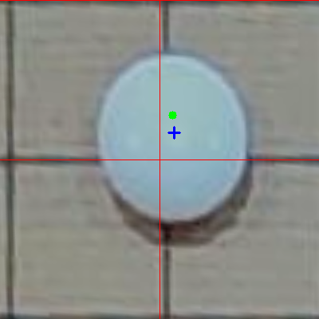
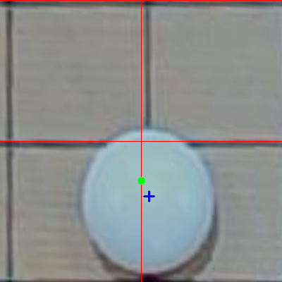

# Why two visibly different White placements both reported 0.28

November 23, 2026. Offline measurement of retained recording
`Diagnostic 2026-11-23 16-37-13 81D4E9F0`, frame 697; installed app 0.253/build 254.
No runtime source, app, hardware, game or calibration changed.

**The two numbers conceal direction, and the fitted centers are above the visible
White bodies.** The recorded fits are −0.28 rows for the legitimately placed
stone and +0.28 for the misplaced stone. Assignment reduces these signed vectors
to an absolute maximum. An independent diagnostic contour measurement distinguishes
the visible bodies: about −0.172 rows versus +0.390 rows. The production fit is
about 0.11 rows above each of those body centers.

| Frame697 measurement | Legitimate White, point 180 | Midway White, point 275 |
|---|---:|---:|
| Nominal grid point (col,row) | (9,9) | (9,14) |
| Recorded fitted center | (9.08,8.72) | (9.00,14.28) |
| Recorded signed row offset | −0.280 | +0.280 |
| Diagnostic visible-body center | (9.090,8.828) | (9.056,14.390) |
| Diagnostic signed row offset | −0.172 | +0.390 |
| Fit minus visible-body row | −0.108 | −0.110 |
| Fit minus visible-body vertical camera pixels | −4.37px | −5.14px |
| Recorded fit radii (columns,rows) | (0.380,0.357) | (0.360,0.338) |
| Diagnostic ellipse principal radii | (0.465,0.508) | (0.471,0.497) |

Thus, approximately: `−0.172 − 0.108 = −0.280`, whereas
`+0.390 − 0.110 = +0.280`. Taking absolute values makes the two final estimates
look identical. They do not describe identical visible placement. These values
measure this image, not general calibration parameters.

## Crops and reproducible measurements

Red lines are nominal printed-grid locations in the archived calibration. Green
dot is the saved production fitted center. Blue cross is the diagnostic contour
centroid. Both crops use the same 200 pixels per grid interval.




The pixel view makes the difference clear: the first body's center is above its
nominal horizontal crossing; the second body's center is substantially below its
assigned crossing. The fitted green points lie above both visible centers. The
correctly placed stone is not optically centered exactly on the board-plane
intersection; its physical contact position and visible body are different things.

`measure.py` reads the exact saved frame metadata and production footprints from
`events.jsonl`. It rectifies only two 2×2-cell crops, using the saved homography and
GrayFrame's `(width−1,height−1)` pixel convention; it does not refit the grid.
A diagnostic cyan-body mask uses B−R thresholds 15, 20, 25, 30, B>145 and G−R>10 on
8-bit BGR pixels. Each crop's largest contour supplies its area centroid and a
least-squares ellipse center. The table uses threshold 20. The complete sweep,
source hashes, model metadata and version information are retained in
[measurements.json](frame697/measurements.json).

This mask was chosen after looking at these two images. It is a scene-specific
measurement aid, **not a new White classifier**, a hand-clearance test, a physical
contact-center estimator, or held-out validation. The threshold sweep checks
sensitivity to this mask, not statistical confidence. The full raw recording
remains in place; only small diagnostic crops are included here.

From repository root, choose an unused output directory:

```sh
python3 PhysicalGo/Experiments/WhiteCentering/measure.py \
  '/Users/dave/SGFPlayerClean/PhysicalGo/Captures/Diagnostics/Diagnostic 2026-11-23 16-37-13 81D4E9F0' \
  /tmp/white-centering-review
```

One OpenCV thread; the retained-frame diagnostic completed in under a second.

## Why the current fitter can do this

`Sources/StoneGeometry.swift:fit` builds a binary vote image from White
color/brightness criteria. It searches disks/ellipses, maximizing
`fraction of White votes inside − 0.7 × fraction in exterior ring`.
That objective is a compact supporting-color region, not an unbiased full-body
outline estimator. It allows radius changes, and this image's recorded fit
radii are appreciably smaller than the independent visible-body ellipse radii.
A partial body can therefore have a strong fit score without the fit center
being the center a person sees.

The default center search extends ±0.44 cells in 0.04 increments. The reported
±0.28 is **not a search-limit clamp**. A 0.04 grid gives nominal rounding error
of at most 0.02 cells for an otherwise accurate continuous center, so search
quantization alone does not explain the measured 0.11-cell discrepancy.
`centeringEvidence` uses a wider search but stricter quality threshold; that does
not by itself supply an independently measured full-body center.

The exact native White vote masks and alternative disk scores have **not** been
exported in this diagnostic. Lower-body color/brightness exclusions, exterior-ring
weighting and the preference for a smaller disk are plausible contributors, but
this report does not claim to have isolated their individual causal contributions.
The measured result is the shared upward fit bias in this one frame. Both raw
White occupancy confidences are 1, which concerns White appearance, not the
accuracy of the fitted center or a probability of legal/centered placement.

## Keep parallax separate; reuse the existing work

There are two different offsets:

1. **Physical board-contact center → visible body center.** Stone height under
   an oblique camera can contribute, alongside actual placement, geometry error
   and lighting-dependent visible contour. This image alone does not separate
   those contributions or measure the hidden contact center.
2. **Visible body center → production fitted center.** This diagnostic measures
   an additional approximately 0.11-cell upward displacement for both White stones.

The November 16 studies already explored a position-dependent stone-height model:
[incident](../../Documentation/LaptopParallaxIncident-2026-11-16.md),
[offline experiment](../../Documentation/OfflineHandParallax-2026-11-16.md), and
`Tools/parallax_lab.py`. They were never installed. A free translation/radial
correction excused a genuinely misplaced stone; the camera-constrained variant
abstained on the negative examples. Its zero false relief was not demonstrated
discrimination. Those experiments required at least six well-spread established
stones and excluded evaluated targets; this sparse four-stone image cannot meet
that support requirement. Do not estimate a global correction from this pair or
move the printed grid to make stone centers fit.

## Independent optical improvement to evaluate

Keep White occupancy evidence separate from centering evidence. Add a second,
full-visible-body contour/edge center with support and uncertainty, using the
existing outline and parallax investigations. Compare it with the current compact
vote fit, preserving signed vectors, radius disagreement and available arc
coverage. A disagreement should reduce centering confidence or request adjustment,
not be averaged away into a confident position.

For contact/intersection assignment, evaluate the visible-body center against a
separately supported expected apparent position from camera/stone-height geometry.
Keep the printed-grid plane fixed. Sparse early-game views need known geometry or
explicit setup examples; they cannot silently borrow a six-anchor model that is
not supported. Include this legitimate/misplaced pair as one development episode,
then hold out different placements/setups, shaded White, clipped rims, mixed-color
crowds and the older real-misplacement negatives. No global threshold reduction,
constant 0.11 shift, automatic admission or native-center replacement is justified
by this one image. The separate neighbor-uncertainty controller fix addresses the
immediate false acceptance while optical centering is evaluated independently.

## Concrete reuse plan for camera angle and varying stone thickness

The board-flattening homography is valuable input. It determines the projective
mapping between the printed plane and camera pixels. With known camera intrinsics,
correct distortion treatment and metric row/column pitch, its decomposition can
provide camera orientation and position relative to that plane. With those values
unknown, a single homography does not independently measure focal length, principal
point, distortion, metric scale and stone height. The earlier `camera_geometry`
function supplies a *conditional pinhole hypothesis*: square pixels, zero skew /
distortion, specified principal point and orthogonal grid directions. Its estimated
pitch ratio and camera height in row-spacing units are conditional, too.

This diagnostic reuses that exact function, without changing it. All 25 principal-
point hypotheses within ±1% of image dimensions are admissible for frame 697. The
central hypothesis gives camera projection (14.29, 23.27), camera height 26.13 row
pitches, focal length 1405 pixels and column/row pitch ratio 1.093. These values are
not measured physical specifications; `assumptionsVerified` remains false.
[The saved hypotheses](frame697/camera-hypotheses.json) include the source hash.
No stone-height field is fitted and no target gains acceptance. This small
sensitivity sweep is not a confidence interval or proof of correct camera geometry.

Reuse the existing stages rather than introduce a free image warp:

1. **Geometry input:** retain `camera_geometry` and the existing principal-point
   sensitivity audit as the fallback. Add an offline path accepting measured
   intrinsics/distortion and measured row/column pitch when available. Preserve
   image crop/resolution and geometry revision; rectification alone must not lose
   the original camera geometry.
2. **Apparent-body center:** first evaluate the full-body estimator separately
   from the compact White-vote fit. Its uncertainty and signed bias must enter
   the field fitting; otherwise a learned “stone height” could merely absorb
   a threshold-induced shape error.
3. **Height/thickness:** reuse the constrained field and `prediction` machinery.
   The idealized model is `apparent(P) = P + k(P−C)`, with
   `k = h/(Hcamera−h)`. Both direction and magnitude vary across the board, and
   thicker stones have a different `k`. Keep a known stone-set/effective-height
   identity; allow separately supported Black/White or thickness-family values,
   rather than assuming color itself determines height. An unknown individual
   thickness gets a bounded range and greater uncertainty, not a freely fitted
   per-point correction. Visible-body effective height need not equal caliper
   thickness of the curved stone.
4. **Contact assignment:** compare the observed body with the predicted apparent
   locations of candidate printed intersections. Alternatively invert the same
   constrained mapping, `P = (apparent + kC)/(1+k)`, with uncertainty propagated
   across admissible camera/height hypotheses. Keep the printed-grid calibration
   fixed; never use a movable grid or unconstrained translation to erase an error.
5. **Learning:** only deliberately centered, user-confirmed examples or otherwise
   separately verified anchors can fit/update height. Exclude the candidate being
   assigned. A self-accepted move, expected AI point or current midway stone must
   not train the field that certifies its own placement. Keep old anchors and a
   rollbackable candidate model.

A bounded physical collection for later authorization could use three representative
White and three Black stones at six well-spread marked intersections, deliberately
centered, with a clear frozen recording confirmed by the user. Then swap the colors
at those locations in a second confirmed round, and reserve separate correctly
centered and intentionally displaced placements for testing. This provides a small
setup exercise while covering two color/stone families across the plane. It does
**not** automatically validate a six-anchor *per-family* model from only three
stones in one frame: the existing routine works on one observation and requires
six well-spread established stones. Accumulating confirmed setup observations or
introducing a measured-height estimator would be a new offline extension with its
own support checks. If families or height ranges are unsupported, abstain.

Strong negative controls must include the present legitimate/midway pair as one
shared-frame episode, the older `CrowdedWhiteAdjustment` real misplacement that
free corrections wrongly excused, `HalfwayNudge`, sparse first-move views, touching
stones, White glare/lower-rim shading, Black highlights, different thicknesses,
edges/corners, changed camera angle and missing/incorrect intrinsics. Fit on the
centered setup examples only; freeze parameters and test displaced stones without
learning from them. Report both correctly relieved legitimate placements and
incorrectly relieved misplacements. A model that abstains on every negative case
has not yet demonstrated discrimination.
