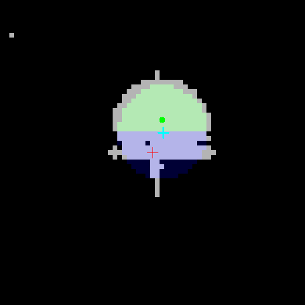
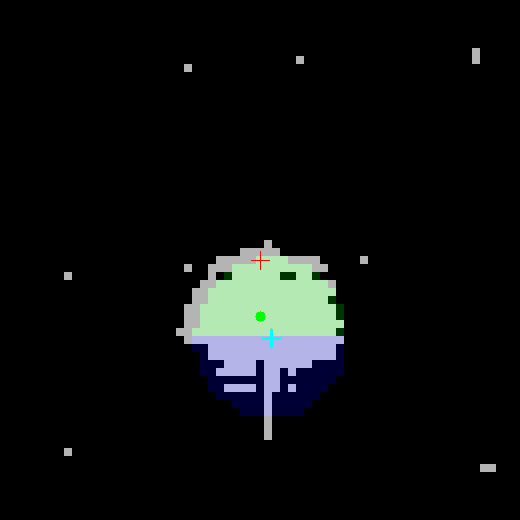

# Native White-vote diagnosis: why the fitted center shifts upward

November 23, 2026. This follows the measured
[White-centering discrepancy](../WhiteCentering/README.md). No app, camera,
laser, game, grid, installed source or runtime threshold changed.

**The native shape fitter is centering a smaller bright region inside each White
stone.** In this frame, its color criterion rejects the cyan-tinted stone body,
so almost all accepted pixels come from a brightness fallback. The dimmer lower
part loses support, and the disk/ring objective favors a smaller, upward-shifted
disk. This is an identified appearance-estimation effect in addition to any
stone-height/parallax effect.

## Exact replay evidence

The diagnostic compiles a generated logging copy of `StoneGeometry.swift` with
the production `BoardVision`, image loading and dependency closure. It reads only
the retained frame 697 and reference. **All four archived footprints are reproduced
exactly**, including both White centers, radii and objective scores. Production
sources remain untouched; the generated source copy and build/source hashes are
saved beside the trace. The Python disk sum independently reproduces both native
White objective scores to better than 1e−12.

Within a conservative ellipse inside each independently measured visible body:

| Exact native evidence | Centered White 180 | Midway White 275 |
|---|---:|---:|
| Upper-body samples passing the White vote | 100.0% | 94.5% |
| Lower-body samples passing the White vote | 73.4% | 52.6% |
| Color-criterion supporting samples, upper/lower | 0 / 0 | 0 / 0 |
| Median upper-body brightness above corrected reference | 0.155 | 0.149 |
| Median lower-body brightness above corrected reference | 0.143 | 0.121 |

The brightness fallback threshold is **+0.12** on a 0–1 scale. The color path
requires the stone to be sufficiently less chromatic than expected wood (including
its cool-color alternative). Here the visible White body's chroma magnitude is
roughly 0.054–0.067, while expected wood is about 0.011–0.014. It therefore fails
that color comparison. These magnitudes describe the source's normalized RGB
chromaticity metric, not perceived whiteness or a calibrated probability.

The shape objective is `inside White-vote fraction − 0.7×outside-ring fraction`:

| Candidate disk under the exact same native vote mask | Centered White 180 | Midway White 275 |
|---|---:|---:|
| Chosen native fit | 0.9212 | 0.9151 |
| Same small disk, re-centered at nearest lattice point to visible-body center | 0.7408 | 0.6434 |
| Larger body-sized disk, at that visible-body center | 0.7223 | 0.5792 |

Thus the optimizer is doing what its input/objective rewards. It is not being
clamped at 0.28, and merely increasing search precision would not prefer the
visible-body center under these votes. The larger comparison disk uses radius 0.46
and aspect 1.06; it is a diagnostic counterfactual, not an optimized replacement.
The observation still classifies these locations as White with raw score 1; that
score concerns class appearance, not certainty that its fitted center is accurate.

## Native masks

Light pixels are native White votes. Green/blue tinted regions mark conservative
upper/lower body interiors used for the table. Red cross is the nominal assigned
intersection, green dot the chosen native center, and cyan cross the independent
visible-body center. This is the native 0.04-cell sampling lattice, enlarged with
nearest-neighbor interpolation.




[explanation.json](explanation.json) preserves exact scores, source links/hashes,
body-center source and limitations. Full native pixel samples, colors, gray values,
criteria, replay output, generated source and build manifest are retained at:

`/Users/dave/Documents/SGF PLayer/work/ai-laser-integration/stone-session-20261123/stone-set-calibration/native-white-votes-01/`.

## Implication and limits

Separate class support from centering confidence. A full-body contour/edge check
and calibrated stone appearance could supply complementary evidence when the
compact bright-region fit excludes a visible rim/body. Record radius/center
agreement and visibility rather than treating a high disk score as accurate
centering. The new confirmed centered-stone samples can help evaluate that path,
but the exploratory cyan-body mask is not a production fix: permissive masks can
connect a stone to lit wood, and shadow/occlusion controls remain necessary.

Do not compensate by lowering the global brightness threshold, adding a constant
upward/downward correction, or changing the board grid based on these two stones.
Do not infer physical thickness from this additional fit bias. Any learned height
must remain tied to the center estimator and geometry assumptions. This diagnostic
isolates the current threshold/objective mechanism in one frame; it does not
validate a general replacement or resolve independent setup/Black-negative tests.

## Reproduce

Choose a new output directory from repository root:

```sh
python3 PhysicalGo/Experiments/WhiteVoteDiagnostic/run.py RECORDING_DIR NEW_TRACE_DIR
python3 PhysicalGo/Experiments/WhiteVoteDiagnostic/analyze.py NEW_TRACE_DIR PhysicalGo/Experiments/WhiteCentering/frame697/measurements.json
```

The first command builds a standalone native replay, not an app. It inserts logging
only into a generated source copy under the output directory; it refuses existing
output directories. The second asserts archived-fit equality and objective parity
before writing its explanation. It uses the exact retained body measurements from
the earlier independent pixel diagnostic. There is no camera/serial access or
profile installation. All runtime classifier and safety behavior stays unchanged.
